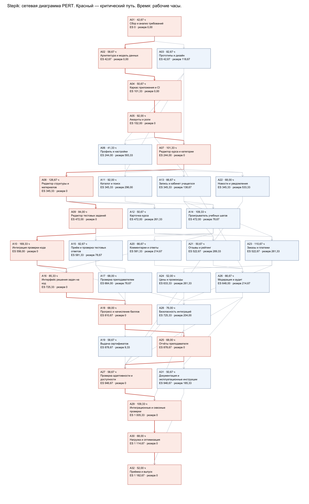
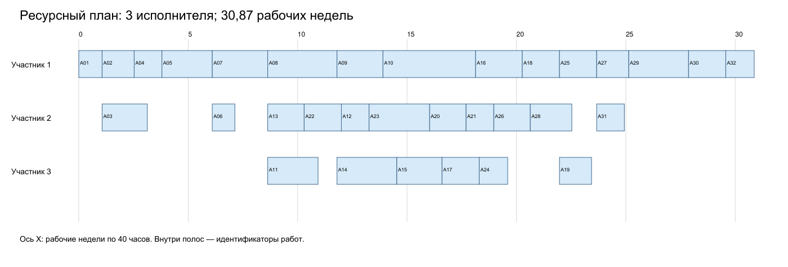

# Лабораторная работа № 1 — Stepik

Авторы: Трикашный Михаил Дмитриевич, Амузинский Артем Андреевич. Группа P3406.

## Содержание

1. Задание и границы исследования
2. Функциональные требования
3. Наивная оценка
4. PERT, критический путь и команда
5. Функциональные точки
6. COCOMO II
7. Use Case Points
8. Сравнение результатов и вывод
9. Источники
## 1. Задание и границы исследования

Цель работы — сформировать требования к веб-проекту по варианту stepik.org и оценить разработку несколькими методами. Объект оценки — новый веб-продукт с согласованным набором функций аналога Stepik. Числа не описывают фактическую стоимость, штат или историю разработки Stepik.

Задание: сформировать функциональные требования; выполнить наивную оценку и PERT; построить сетевую диаграмму, найти критический путь и предложить команду; оценить функциональные точки и трудоёмкость COCOMO II; выполнить UCP с калибровкой PF по собственному завершённому проекту; сравнить результаты. Planning Poker требуется для трёх участников; работу выполняют два человека.

Исследование проведено 14.09.2026 по публичному каталогу [S1] и официальным справочным статьям [S2–S11]. Каталог загружается динамически; его интерфейс и закрытые кабинеты не проходили интерактивное тестирование. Требования основаны на документации. Конкретные правила приёмки, архитектура, нагрузка и численные оценки являются проектными допущениями.

Веб-версия включает аккаунты, каталог, обучение, тесты трёх типов, задачи на код, ручную проверку преподавателем, прогресс, сертификаты, обсуждения, авторский редактор, отчёты, оплату, промокоды и модерацию. Структура курса и создание материалов подтверждены [S3, S4], проверка заданий — [S5], покупка доступа — [S6].

Внешние готовые сервисы: один платёжный провайдер, изолированная проверка Python-кода, доставка email и объектное хранилище видео/файлов. Включены разработка адаптеров, обработка ошибок и проверка интеграций. Собственные платёжный процессинг, видеотранскодер и изолирующая среда исполнения не разрабатываются. Это решение для оцениваемого аналога, а не описание внутренней архитектуры Stepik.

За границами: мобильные приложения, офлайн-режим, ML-рекомендации, программы из нескольких курсов, корпоративные классы, LTI, SQL/HTML-задачи, peer review, рассрочки, подарки, автоматизация возвратов и выплат авторам, производство учебного контента и длительное сопровождение. Обращения по возвратам в этой версии обрабатывает оператор вне приложения. Все четыре метода используют именно эти функциональные границы.

Результат разработки — принятая и развёрнутая версия. В WBS включены анализ, дизайн, интеграции, тестирование, документация и выпуск. На одну работу назначается один исполнитель; тесты модуля входят в его реализацию, отдельные работы проверки отвечают за межмодульные сценарии. Неделя — 40 рабочих часов, день — 8. Номинальный человеко-месяц COCOMO — 152 часа [M2].

Авторы сообщили об отсутствии собственного завершённого проекта с известными трудозатратами. Поэтому экспериментальная калибровка PF в пункте 5 задания не выполнена. Раздел UCP содержит полный подсчёт размера и анализ чувствительности к условному PF; это ограничение сохранено в выводах.

## 2. Функциональные требования

В колонке «Основание» S — источник из раздела 9; П — проектное допущение. Критерии приёмки относятся к разрабатываемому аналогу. Они делают оценку проверяемой, но не утверждают, что реальный Stepik реализует все технические детали именно так.

### Аккаунт

FR01. Регистрация и подтверждение email. Новый адрес создаёт аккаунт; повторный адрес отклоняется; ссылка подтверждает адрес однократно. Основание: [S4; П: детали проверки].

FR02. Вход, выход и восстановление пароля. Верные данные открывают сессию; выход закрывает её; использованный токен сброса повторно не действует. Основание: [S4; П: сценарии безопасности].

FR03. Профиль и настройки уведомлений. Учащийся сохраняет имя и предпочтения; другой пользователь не может их изменить. Основание: [S8; П: поля профиля].

### Каталог

FR04. Каталог, категории, поиск и фильтры. По запросу и выбранным категории, языку и платности возвращаются подходящие опубликованные курсы. Основание: [S1, S2, S10; П: набор фильтров].

FR05. Карточка курса. Посетитель видит описание, автора, программу, цену и условия сертификата до записи. Основание: [S3, S6, S7; П: состав карточки].

### Обучение

FR06. Запись и список моих курсов. Запись на бесплатный курс создаёт один доступ; повторный запрос не дублирует его; курс появляется в кабинете. Основание: [S2, S6; П: идемпотентность].

FR07. Просмотр текстовых и видеошагов. Зачисленный учащийся открывает доступный шаг, просматривает материал и возвращается к последней позиции. Основание: [S3; П: сохранение позиции].

FR08. Решение тестовых задач. Выбор варианта, число и строка проверяются по правилам автора; сохраняются ответ и результат попытки. Основание: [S5; П: три типа в границах].

FR09. Решение задач на программирование. Код отправляется на проверку; учащийся получает статус, итог тестов и диагностическое сообщение; скрытые тесты не раскрываются. Основание: [S5; П: интеграция с готовым grader].

FR10. Прогресс и баллы. Принятый результат обновляет баллы и долю пройденных шагов; повторный callback не удваивает баллы. Основание: [S3, S9; П: правило повторов].

FR11. Сертификат. При включённом сертификате и достижении порога формируется документ с именем, курсом, баллами и проверочной ссылкой. Основание: [S7; П: формат документа].

### Общение

FR12. Комментарии и ответы. Участник оставляет комментарий к шагу, отвечает и удаляет собственный; преподаватель может модерировать обсуждение. Основание: [S8, S11].

FR13. Отзывы о курсе. Зачисленный пользователь публикует оценку и текст; одна актуальная оценка на пользователя учитывается в среднем рейтинге. Основание: [S11; П: правила агрегации].

FR14. Новости и уведомления. Автор публикует новость; учащийся видит уведомление и может прочитать его; email учитывает настройки профиля. Основание: [S8; П: доставка через email API].

### Преподавание

FR15. Создание и редактирование курса. Автор создаёт черновик, меняет описание и категорию, выбирает публичный или приватный доступ, публикует заполненный курс. Основание: [S4, S10; П: валидация публикации].

FR16. Структура и материалы курса. Автор добавляет, редактирует, упорядочивает и удаляет модули, уроки, текстовые и видеошаги с проверкой зависимостей. Основание: [S3, S4; П: запрет удаления использованного шага].

FR17. Настройка практических задач. Автор сохраняет условие, эталон, баллы; для кода задаёт язык, лимиты и тесты, затем запускает пробную проверку. Основание: [S5; П: готовый grader, один язык Python].

FR18. Проверка свободного ответа. Преподаватель открывает ответ, назначает баллы и обратную связь; учащийся видит результат. Основание: [S5; П: только преподаватель, без peer review].

FR19. Команда курса и доступ. Владелец назначает соавтора, снимает роль, выдаёт и отзывает доступ к приватному курсу. Основание: [S4; П: упрощённые роли].

FR20. Статистика и экспорт результатов. Преподаватель получает таблицу прогресса и баллов своих учащихся и выгружает CSV; чужой курс недоступен. Основание: [S9; П: формат CSV].

### Монетизация

FR21. Покупка доступа. Создаётся заказ и переход к провайдеру; только подтверждённый серверный статус выдаёт доступ; неуспех сохраняет заказ неоплаченным. Основание: [S6; П: единый провайдер, callback].

FR22. Цена и промокоды. Автор меняет цену и создаёт промокод со сроком и лимитом; допустимый код снижает стоимость заказа. Основание: [S6; П: ограничения промокодов].

### Администрирование

FR23. Модерация и ограничения. Модератор скрывает нарушающий правила материал и ограничивает общение пользователя; действие записывается в журнал. Основание: [S11; П: журнал действий].

FR24. Управление справочником категорий. Администратор создаёт, переименовывает и архивирует категорию; архивная категория недоступна для нового назначения. Основание: [S10; П: административный интерфейс].

### Ограничения качества и риски

| Область | Принятое допущение / критерий |
| --- | --- |
| Нагрузка | До 1 000 одновременно активных сессий и 20 отправок заданий/с; p95 обычного API ≤ 1 с на согласованном стенде. Время внешней проверки учитывается отдельно. |
| Безопасность | Проверка ролей на сервере, хеширование паролей, подписи callback, отсутствие доступа к чужим попыткам. Grader запускает код в готовой изолированной среде. |
| Надёжность | Повторное подтверждение оплаты и результата задания не создаёт второй доступ или дополнительные баллы; резервное копирование и проверка восстановления. |
| Интерфейс | Адаптивная веб-версия, основные сценарии доступны с клавиатуры; состояния ожидания, пустых данных и отказа сервиса. |
| Основной риск | Недооценка интеграции grader и платежей. У работ A10 и A23 расширена пессимистическая оценка; внешние тарифы и эксплуатационные расходы в часах разработки не учитываются. |

## 3. Наивная оценка

Для каждой работы заданы оптимистическая O, наиболее вероятная M и пессимистическая P оценки в человеко-часах. Наивный метод суммирует M и предполагает выполнение всех перечисленных работ без дополнительного статистического резерва. Это экспертные оценки, а не измерения.

| ID | Работа | O | M | P |
| --- | --- | --- | --- | --- |
| A01 | Сбор и анализ требований | 24 | 40 | 72 |
| A02 | Архитектура и модель данных | 32 | 56 | 96 |
| A03 | Прототипы и дизайн | 48 | 80 | 128 |
| A04 | Каркас приложения и CI | 32 | 48 | 80 |
| A05 | Аккаунты и роли | 56 | 88 | 144 |
| A06 | Профиль и настройки | 24 | 40 | 64 |
| A07 | Редактор курса и категории | 64 | 96 | 160 |
| A08 | Редактор структуры и материалов | 80 | 120 | 200 |
| A09 | Редактор тестовых заданий | 48 | 80 | 136 |
| A10 | Интеграция проверки кода | 96 | 160 | 280 |
| A11 | Каталог и поиск | 56 | 88 | 144 |
| A12 | Карточка курса | 32 | 48 | 80 |
| A13 | Запись и кабинет учащегося | 40 | 64 | 104 |
| A14 | Проигрыватель учебных шагов | 64 | 104 | 176 |
| A15 | Приём и проверка тестовых ответов | 48 | 80 | 128 |
| A16 | Интерфейс решения задач на код | 48 | 80 | 144 |
| A17 | Проверка преподавателем | 40 | 64 | 112 |
| A18 | Прогресс и начисление баллов | 40 | 64 | 112 |
| A19 | Выдача сертификатов | 32 | 56 | 96 |
| A20 | Комментарии и ответы | 40 | 64 | 104 |
| A21 | Отзывы и рейтинг | 32 | 48 | 80 |
| A22 | Новости и уведомления | 40 | 64 | 112 |
| A23 | Заказы и платежи | 64 | 104 | 184 |
| A24 | Цены и промокоды | 32 | 48 | 88 |
| A25 | Отчёты преподавателя | 40 | 64 | 112 |
| A26 | Модерация и аудит | 40 | 64 | 104 |
| A27 | Проверка адаптивности и доступности | 32 | 56 | 96 |
| A28 | Безопасность интеграций | 40 | 72 | 128 |
| A29 | Интеграционные и сквозные проверки | 64 | 104 | 176 |
| A30 | Нагрузка и оптимизация | 40 | 64 | 112 |
| A31 | Документация и эксплуатационные инструкции | 32 | 48 | 80 |
| A32 | Приёмка и выпуск | 32 | 48 | 88 |

Наивная трудоёмкость: H = ΣM = 2304 чел·ч. Для одного исполнителя это 288,00 рабочих дней или 57,60 рабочих недель. Деление на размер команды само по себе не учитывает зависимости.

Подробный результат каждой работы и её связь с FR приведены на листе «Работы» книги Excel. A01–A04 создают основу; A05–A26 реализуют функции; A27–A32 проверяют качество и выпускают продукт. Модульные тесты и обычные исправления включены в оценки реализации, чтобы не добавлять их второй раз к итогу.

## 4. PERT, критический путь и команда

Для работы i: TEᵢ = (Oᵢ + 4Mᵢ + Pᵢ)/6; σᵢ = (Pᵢ − Oᵢ)/6; Varᵢ = σᵢ². Ожидаемая трудоёмкость H = ΣTEᵢ. При независимости длительностей σH = √ΣVarᵢ. В расчётах сохраняется полная точность, округление применяется только при выводе.

| ID | Предшественники | TE, чел·ч | σ, чел·ч | Var, ч² |
| --- | --- | --- | --- | --- |
| A01 | — | 42,67 | 8,00 | 64,00 |
| A02 | A01 | 58,67 | 10,67 | 113,78 |
| A03 | A01 | 82,67 | 13,33 | 177,78 |
| A04 | A02 | 50,67 | 8,00 | 64,00 |
| A05 | A04 | 92,00 | 14,67 | 215,11 |
| A06 | A05, A03 | 41,33 | 6,67 | 44,44 |
| A07 | A05, A03 | 101,33 | 16,00 | 256,00 |
| A08 | A07 | 126,67 | 20,00 | 400,00 |
| A09 | A08 | 84,00 | 14,67 | 215,11 |
| A10 | A09 | 169,33 | 30,67 | 940,44 |
| A11 | A07, A03 | 92,00 | 14,67 | 215,11 |
| A12 | A08, A11 | 50,67 | 8,00 | 64,00 |
| A13 | A05, A07, A03 | 66,67 | 10,67 | 113,78 |
| A14 | A08, A13 | 109,33 | 18,67 | 348,44 |
| A15 | A09, A14 | 82,67 | 13,33 | 177,78 |
| A16 | A10, A14 | 85,33 | 16,00 | 256,00 |
| A17 | A15 | 68,00 | 12,00 | 144,00 |
| A18 | A15, A16, A17 | 68,00 | 12,00 | 144,00 |
| A19 | A18 | 58,67 | 10,67 | 113,78 |
| A20 | A14 | 66,67 | 10,67 | 113,78 |
| A21 | A12, A13 | 50,67 | 8,00 | 64,00 |
| A22 | A06, A07 | 68,00 | 12,00 | 144,00 |
| A23 | A12, A13 | 110,67 | 20,00 | 400,00 |
| A24 | A23 | 52,00 | 9,33 | 87,11 |
| A25 | A18 | 68,00 | 12,00 | 144,00 |
| A26 | A20, A21, A07 | 66,67 | 10,67 | 113,78 |
| A27 | A19, A22, A24, A25, A26 | 58,67 | 10,67 | 113,78 |
| A28 | A10, A23, A26 | 76,00 | 14,67 | 215,11 |
| A29 | A27, A28 | 109,33 | 18,67 | 348,44 |
| A30 | A29 | 68,00 | 12,00 | 144,00 |
| A31 | A25, A26, A24 | 50,67 | 8,00 | 64,00 |
| A32 | A30, A31 | 52,00 | 9,33 | 87,11 |

H(PERT) = 2 428,00 чел·ч; σH = 78,15 чел·ч. При нормальном приближении 95%-й интервал общей трудоёмкости: H ± 1,96σH = [2 274,84; 2 581,16] чел·ч. Коррелированные риски могут расширить этот интервал; это не гарантия и не интервал даты релиза.

### 4.1. Сетевая диаграмма и прямой/обратный проход

Используется граф «работа в узле» (AON), связь finish-to-start без задержки. A01 — начало, A32 — завершение. Длительность узла равна TE в рабочих часах при одном исполнителе. ES = max(EF предшественников), EF = ES + TE; LF = min(LS последователей), LS = LF − TE. Полный резерв R = LS − ES. Для начала ES = 0, для завершающей работы LF равно длине критического пути.

Редактируемый полный граф: «Сетевая диаграмма.drawio». Для чтения с увеличением приложены docs/network.svg и docs/network.pdf. Все стрелки построены из того же списка зависимостей, что и таблица CPM.

| ID | ES | EF | LS | LF | Резерв |
| --- | --- | --- | --- | --- | --- |
| A01 | 0 | 42,67 | 0,00 | 42,67 | 0,00 |
| A02 | 42,67 | 101,33 | 42,67 | 101,33 | 0,00 |
| A03 | 42,67 | 125,33 | 161,33 | 244,00 | 118,67 |
| A04 | 101,33 | 152,00 | 101,33 | 152,00 | 0,00 |
| A05 | 152,00 | 244,00 | 152,00 | 244,00 | 0 |
| A06 | 244,00 | 285,33 | 837,33 | 878,67 | 593,33 |
| A07 | 244,00 | 345,33 | 244,00 | 345,33 | 0 |
| A08 | 345,33 | 472,00 | 345,33 | 472,00 | 0 |
| A09 | 472,00 | 556,00 | 472,00 | 556,00 | 0 |
| A10 | 556,00 | 725,33 | 556,00 | 725,33 | 0 |
| A11 | 345,33 | 437,33 | 641,33 | 733,33 | 296,00 |
| A12 | 472,00 | 522,67 | 733,33 | 784,00 | 261,33 |
| A13 | 345,33 | 412,00 | 484,00 | 550,67 | 138,67 |
| A14 | 472,00 | 581,33 | 550,67 | 660,00 | 78,67 |
| A15 | 581,33 | 664,00 | 660,00 | 742,67 | 78,67 |
| A16 | 725,33 | 810,67 | 725,33 | 810,67 | 0 |
| A17 | 664,00 | 732,00 | 742,67 | 810,67 | 78,67 |
| A18 | 810,67 | 878,67 | 810,67 | 878,67 | 0 |
| A19 | 878,67 | 937,33 | 888,00 | 946,67 | 9,33 |
| A20 | 581,33 | 648,00 | 796,00 | 862,67 | 214,67 |
| A21 | 522,67 | 573,33 | 812,00 | 862,67 | 289,33 |
| A22 | 345,33 | 413,33 | 878,67 | 946,67 | 533,33 |
| A23 | 522,67 | 633,33 | 784,00 | 894,67 | 261,33 |
| A24 | 633,33 | 685,33 | 894,67 | 946,67 | 261,33 |
| A25 | 878,67 | 946,67 | 878,67 | 946,67 | 0 |
| A26 | 648,00 | 714,67 | 862,67 | 929,33 | 214,67 |
| A27 | 946,67 | 1 005,33 | 946,67 | 1 005,33 | 0 |
| A28 | 725,33 | 801,33 | 929,33 | 1 005,33 | 204,00 |
| A29 | 1 005,33 | 1 114,67 | 1 005,33 | 1 114,67 | 0 |
| A30 | 1 114,67 | 1 182,67 | 1 114,67 | 1 182,67 | 0 |
| A31 | 946,67 | 997,33 | 1 132,00 | 1 182,67 | 185,33 |
| A32 | 1 182,67 | 1 234,67 | 1 182,67 | 1 234,67 | 0 |

Критический путь: A01 → A02 → A04 → A05 → A07 → A08 → A09 → A10 → A16 → A18 → A25 → A27 → A29 → A30 → A32.

Его длина 1 234,67 рабочих часов = 154,33 рабочих дней = 30,87 рабочих недель. Это нижняя граница срока при достаточных ресурсах. Суммарная трудоёмкость остаётся 2 428,00 чел·ч.

Для фиксированного критического пути σCP = 59,21 ч; интервал TE(CP) ± 1,96σCP = [1 118,62; 1 350,72] ч. При изменении длительностей критическим может стать другой путь, поэтому этот интервал не является 95%-м обещанием срока всего проекта.

### 4.2. Ресурсное расписание и состав команды

Построены расписания для 1–8 взаимозаменяемых исполнителей. В момент освобождения ресурса выбирается доступная работа с самым длинным оставшимся путём до конца; при равенстве — меньший ID. Работа не прерывается и не ускоряется назначением нескольких людей. Нижняя граница срока для n человек: max(CP, H/n).

| Человек | Нижняя граница, ч | Полученный срок, ч | Недели | Загрузка, % |
| --- | --- | --- | --- | --- |
| 1 | 2 428,00 | 2 428,00 | 60,70 | 100,00 |
| 2 | 1 234,67 | 1 425,33 | 35,63 | 85,17 |
| 3 | 1 234,67 | 1 234,67 | 30,87 | 65,55 |
| 4 | 1 234,67 | 1 234,67 | 30,87 | 49,16 |
| 5 | 1 234,67 | 1 234,67 | 30,87 | 39,33 |
| 6 | 1 234,67 | 1 234,67 | 30,87 | 32,78 |
| 7 | 1 234,67 | 1 234,67 | 30,87 | 28,09 |
| 8 | 1 234,67 | 1 234,67 | 30,87 | 24,58 |

Критерий выбора: наименьшая из рассмотренных команд, чьё построенное расписание не более чем на 10% длиннее CPM. Рекомендуются 3 разработчика с совмещением ролей; срок 30,87 рабочих недель, загрузка 65,55%. Это рациональный вариант по выбранному критерию, а не доказанный глобальный оптимум задачи ресурсного планирования.

Предлагаемое распределение специализаций: два разработчика frontend/backend и 1 участника с компетенциями full-stack, автоматизации тестирования и DevOps. Дизайн, анализ и документация распределяются по этапам. Предположение о взаимозаменяемости упрощает реальную ситуацию; дефицит нужной компетенции увеличит срок.

Для рабочего плана принимается 80% доступности участников на проект. При равномерном снижении доступности срок составляет 38,58 рабочих недель. Дополнительный управленческий резерв 15% даёт 44,37 недель. Эти проценты — допущения планирования, а не статистический результат PERT; снижение доступности увеличивает срок делением на 0,8.

| ID | Исполнитель | Начало, ч | Окончание, ч |
| --- | --- | --- | --- |
| A01 | 1 | 0,00 | 42,67 |
| A02 | 1 | 42,67 | 101,33 |
| A03 | 2 | 42,67 | 125,33 |
| A04 | 1 | 101,33 | 152,00 |
| A05 | 1 | 152,00 | 244,00 |
| A06 | 2 | 244,00 | 285,33 |
| A07 | 1 | 244,00 | 345,33 |
| A08 | 1 | 345,33 | 472,00 |
| A09 | 1 | 472,00 | 556,00 |
| A10 | 1 | 556,00 | 725,33 |
| A11 | 3 | 345,33 | 437,33 |
| A12 | 2 | 480,00 | 530,67 |
| A13 | 2 | 345,33 | 412,00 |
| A14 | 3 | 472,00 | 581,33 |
| A15 | 3 | 581,33 | 664,00 |
| A16 | 1 | 725,33 | 810,67 |
| A17 | 3 | 664,00 | 732,00 |
| A18 | 1 | 810,67 | 878,67 |
| A19 | 3 | 878,67 | 937,33 |
| A20 | 2 | 641,33 | 708,00 |
| A21 | 2 | 708,00 | 758,67 |
| A22 | 2 | 412,00 | 480,00 |
| A23 | 2 | 530,67 | 641,33 |
| A24 | 3 | 732,00 | 784,00 |
| A25 | 1 | 878,67 | 946,67 |
| A26 | 2 | 758,67 | 825,33 |
| A27 | 1 | 946,67 | 1 005,33 |
| A28 | 2 | 825,33 | 901,33 |
| A29 | 1 | 1 005,33 | 1 114,67 |
| A30 | 1 | 1 114,67 | 1 182,67 |
| A31 | 2 | 946,67 | 997,33 |
| A32 | 1 | 1 182,67 | 1 234,67 |

## 5. Оценка методом функциональных точек

Выполняется предварительный подсчёт размера нового приложения. Граница охватывает пользовательские функции FR01–FR24; внешние API остаются за ней. ILF — поддерживаемая приложением логическая группа данных, EIF — читаемая группа, поддерживаемая другим приложением. EI — ввод с изменением данных/управления, EO — вывод с вычислением или производным результатом, EQ — запрос без такого вычисления. [M2, раздел 2]

API оплаты, grader, email и хранилище сами по себе не являются EIF. В принятых границах приложение не читает отдельные внешние справочники; ответ сервиса обрабатывается транзакцией, а нужное состояние сохраняется в ILF. Поэтому EIF = 0. Прогресс вычисляется из попыток, а не считается отдельным ILF; наличие отдельной физической таблицы не добавляет функциональные точки.

RET — число логических подгрупп записей, DET — пользовательски различимых полей, FTR — число логических групп, читаемых или изменяемых процессом. Значения предполагаются для проектируемого аналога. Состав групп указан в Excel; это предварительная FPA-оценка, требующая уточнения по спецификации полей и потоков.

### 5.1. Правила сложности

| Группа | Строки матрицы | Столбцы матрицы | Низкая / средняя / высокая |
| --- | --- | --- | --- |
| ILF / EIF | RET: 1; 2–5; ≥6 | DET: 1–19; 20–50; ≥51 | Н Н С / Н С В / С В В |
| EI | FTR: 0–1; 2; ≥3 | DET: 1–4; 5–15; ≥16 | Н Н С / Н С В / С В В |
| EO / EQ | FTR: 0–1; 2–3; ≥4 | DET: 1–5; 6–19; ≥20 | Н Н С / Н С В / С В В |

| Тип | Низкая | Средняя | Высокая |
| --- | --- | --- | --- |
| ILF | 7 | 10 | 15 |
| EIF | 5 | 7 | 10 |
| EI | 3 | 4 | 6 |
| EO | 4 | 5 | 7 |
| EQ | 3 | 4 | 6 |

### 5.2. Логические данные

| ID | Группа ILF | RET | DET | Сложность | FP |
| --- | --- | --- | --- | --- | --- |
| D01 | Пользователи | 2 | 18 | Низкая | 7 |
| D02 | Курсы | 3 | 32 | Средняя | 10 |
| D03 | Учебные материалы | 3 | 28 | Средняя | 10 |
| D04 | Задания | 3 | 24 | Средняя | 10 |
| D05 | Записи на курсы | 1 | 8 | Низкая | 7 |
| D06 | Попытки и результаты | 2 | 18 | Низкая | 7 |
| D07 | Обсуждения | 2 | 12 | Низкая | 7 |
| D08 | Отзывы | 1 | 8 | Низкая | 7 |
| D09 | Заказы | 2 | 18 | Низкая | 7 |
| D10 | Промокоды | 1 | 9 | Низкая | 7 |
| D11 | Сертификаты | 1 | 9 | Низкая | 7 |
| D12 | Новости и уведомления | 2 | 15 | Низкая | 7 |
| D13 | Категории | 1 | 5 | Низкая | 7 |
| D14 | Журнал модерации | 1 | 9 | Низкая | 7 |

Сумма ILF = 107 FP. EIF = 0 FP. Например, D02 имеет 3 RET и 32 DET: средняя сложность, 10 FP; D01 с 2 RET и 18 DET имеет низкую сложность, 7 FP.

### 5.3. Транзакции

Создание и изменение сущности считаются отдельно там, где различаются элементарный процесс и проверки. Поиск вместе с фильтрами образует один процесс. Табличный отчёт и его CSV-представление объединены при одинаковой обработке. Вариант с разной обработкой потребовал бы отдельного подсчёта. Полный список FTR-групп и связь с FR находятся на листе «FP транзакции».

| ID | Элементарный процесс | Тип | FTR | DET | FP |
| --- | --- | --- | --- | --- | --- |
| F01 | Регистрация | EI | 1 | 6 | 3 |
| F02 | Подтверждение email | EI | 1 | 2 | 3 |
| F03 | Вход | EI | 1 | 3 | 3 |
| F04 | Выход | EI | 1 | 1 | 3 |
| F05 | Запрос сброса пароля | EI | 1 | 2 | 3 |
| F06 | Смена пароля по токену | EI | 1 | 3 | 3 |
| F07 | Изменение профиля и настроек | EI | 1 | 10 | 3 |
| F08 | Чтение профиля | EQ | 1 | 12 | 3 |
| F09 | Поиск и фильтрация каталога | EQ | 2 | 12 | 4 |
| F10 | Просмотр карточки курса | EQ | 4 | 22 | 6 |
| F11 | Запись на бесплатный курс | EI | 3 | 3 | 4 |
| F12 | Список моих курсов | EQ | 2 | 10 | 4 |
| F13 | Просмотр шага | EQ | 3 | 14 | 4 |
| F14 | Сохранение позиции | EI | 2 | 3 | 3 |
| F15 | Отправка тестового ответа | EI | 3 | 5 | 6 |
| F16 | Отправка кода | EI | 3 | 6 | 6 |
| F17 | Получение результата grader | EI | 2 | 8 | 4 |
| F18 | Отображение результата попытки | EQ | 2 | 9 | 4 |
| F19 | Расчёт и показ прогресса | EO | 4 | 12 | 7 |
| F20 | Формирование сертификата | EO | 4 | 10 | 7 |
| F21 | Проверка сертификата по ссылке | EQ | 3 | 8 | 4 |
| F22 | Публикация комментария или ответа | EI | 3 | 4 | 4 |
| F23 | Удаление собственного комментария | EI | 2 | 2 | 3 |
| F24 | Чтение обсуждения | EQ | 2 | 10 | 4 |
| F25 | Создание отзыва | EI | 2 | 5 | 4 |
| F26 | Изменение отзыва | EI | 2 | 5 | 4 |
| F27 | Показ отзывов и среднего рейтинга | EO | 2 | 9 | 5 |
| F28 | Публикация новости | EI | 3 | 5 | 6 |
| F29 | Чтение уведомлений | EQ | 1 | 8 | 3 |
| F30 | Отметка уведомления прочитанным | EI | 1 | 2 | 3 |
| F31 | Создание черновика курса | EI | 3 | 8 | 6 |
| F32 | Редактирование описания курса | EI | 3 | 20 | 6 |
| F33 | Публикация курса | EI | 3 | 3 | 4 |
| F34 | Создание элемента структуры | EI | 2 | 8 | 4 |
| F35 | Редактирование материала и порядка | EI | 2 | 14 | 4 |
| F36 | Удаление элемента структуры | EI | 3 | 2 | 4 |
| F37 | Создание тестового задания | EI | 2 | 15 | 4 |
| F38 | Редактирование тестового задания | EI | 2 | 15 | 4 |
| F39 | Создание задания на код | EI | 2 | 18 | 6 |
| F40 | Редактирование задания на код | EI | 2 | 18 | 6 |
| F41 | Пробная проверка задания | EI | 2 | 6 | 4 |
| F42 | Отправка свободного ответа | EI | 3 | 4 | 4 |
| F43 | Оценка ответа преподавателем | EI | 3 | 5 | 6 |
| F44 | Очередь ответов на проверку | EQ | 3 | 12 | 4 |
| F45 | Назначение соавтора | EI | 2 | 3 | 3 |
| F46 | Снятие роли соавтора | EI | 2 | 2 | 3 |
| F47 | Выдача приватного доступа | EI | 3 | 4 | 4 |
| F48 | Отзыв приватного доступа | EI | 2 | 2 | 3 |
| F49 | Расчёт отчёта и экспорт CSV | EO | 4 | 18 | 7 |
| F50 | Создание заказа и применение промокода | EI | 4 | 9 | 6 |
| F51 | Обработка статуса платежа | EI | 3 | 7 | 6 |
| F52 | Просмотр статуса заказа | EQ | 2 | 8 | 4 |
| F53 | Изменение цены | EI | 2 | 3 | 3 |
| F54 | Создание промокода | EI | 2 | 9 | 4 |
| F55 | Скрытие контента модератором | EI | 5 | 5 | 6 |
| F56 | Ограничение общения пользователя | EI | 2 | 4 | 3 |
| F57 | Просмотр журнала модерации | EQ | 2 | 10 | 4 |
| F58 | Создание категории | EI | 1 | 5 | 3 |
| F59 | Изменение категории | EI | 1 | 5 | 3 |
| F60 | Архивация категории | EI | 2 | 2 | 3 |

Транзакции = 254 FP. Невыровненный размер UFP = 107 + 0 + 254 = 361 FP.

### 5.4. Выравнивание

Для сопоставимости с форматом лабораторной дополнительно рассчитывается традиционный VAF по 14 характеристикам (DI от 0 до 5). Это отдельная учебная поправка; в COCOMO II используется UFP, чтобы не учитывать общие факторы повторно.

| Характеристика | DI |
| --- | --- |
| Обмен данными | 4 |
| Распределённая обработка | 3 |
| Производительность | 3 |
| Ограничения конфигурации | 1 |
| Частота транзакций | 3 |
| Интерактивный ввод | 5 |
| Эффективность пользователя | 4 |
| Интерактивное обновление | 4 |
| Сложность обработки | 3 |
| Повторное использование | 2 |
| Простота установки | 2 |
| Удобство эксплуатации | 3 |
| Несколько площадок | 1 |
| Удобство изменений | 4 |

ΣDI = 42; VAF = 0,65 + 0,01 × ΣDI = 1,07; AFP = UFP × VAF = 386,27 FP.

## 6. Трудоёмкость по COCOMO II

Выбрана COCOMO II.2000 Early Design: архитектура только предполагается и локальной статистики нет. Используется семь агрегированных множителей и пять факторов масштаба. Коэффициенты и формулы взяты из руководства USC [M2, таблицы 62–63]. Уровни факторов — экспертные допущения для оцениваемой команды.

### 6.1. Размер и факторы

Предполагаемый прикладной стек — JavaScript на сервере и в браузере; это не утверждение о стеке Stepik. QSM [M1] даёт среднее 47 логических SLOC/FP. Код готовых библиотек и внешних сервисов не включается. SLOC = 361 × 47 = 16967; KSLOC = 16,97. Используется UFP = 361; AFP не подставляется.

| Фактор | Значение | Уровень | Обоснование |
| --- | --- | --- | --- |
| PREC | 3,72 | Nominal | Типовая LMS, но нет опыта именно этого продукта. |
| FLEX | 3,04 | Nominal | Функциональные границы согласованы, интерфейсы допускают изменения. |
| RESL | 4,24 | Nominal | Архитектура предварительная, интеграционные риски остаются. |
| TEAM | 3,29 | Nominal | Предполагается обычная сработанность проектной команды. |
| PMAT | 4,68 | Nominal | Учебное допущение об обычной зрелости процесса. |

ΣSF = 18,97; E = 0,91 + 0,01 × ΣSF = 1.0997.

| Множитель | Значение | Уровень | Обоснование |
| --- | --- | --- | --- |
| PERS | 1,00 | Nominal | Нет подтверждённых данных о производительности команды. |
| RCPX | 1,33 | High | Платежи, оценивание и асинхронная проверка повышают сложность. |
| PDIF | 1,00 | Nominal | Нет жёстких аппаратных ограничений. |
| PREX | 1,00 | Nominal | Средний опыт стека и предметной области — допущение. |
| FCIL | 0,87 | High | Готовые CI, средства тестирования и совместной работы. |
| RUSE | 1,00 | Nominal | Повторное использование в рамках проекта. |
| SCED | 1,00 | Nominal | Срок искусственно не сжимается. |

EAF = произведение EM = 1.1571. PM = 2,94 × KSLOC^E × EAF = 76,54 чел·мес. При 152 чел·ч/месяц трудоёмкость составляет 11 634,79 чел·ч.

### 6.2. Срок и чувствительность

При номинальном SCED: F = 0,28 + 0,2(E − 0,91) = 0.3179; TDEV = 3,67 × PM^F = 14,58 календарных месяцев. Средняя численность PM/TDEV = 5,25 человека. Это модельная средняя занятость, а не постоянный штат с первого дня.

| SLOC/FP | KSLOC | PM | Чел·ч | TDEV, мес. |
| --- | --- | --- | --- | --- |
| 31 | 11,19 | 48,44 | 7 362,12 | 12,60 |
| 47 | 16,97 | 76,54 | 11 634,79 | 14,58 |
| 63 | 22,74 | 105,64 | 16 057,85 | 16,15 |

Значения 31 и 63 — границы наблюдавшегося диапазона JavaScript в QSM, а не доверительный интервал нашего проекта. Разброс показывает чувствительность к переводу функциональных точек в строки кода. Размер самого FP-подсчёта также неопределён.

COCOMO охватывает инженерные работы и тестирование в определённых моделью фазах; начальная проработка концепции и длительная эксплуатация требуют отдельного согласования границ. В этой работе модель служит независимой проверкой порядка величины, без произвольной добавки «за тестирование». WBS включает ранний анализ и выпуск, поэтому строгое равенство охвата фаз и точности методов не предполагается.

## 7. Метод Use Case Points

Акторы классифицируются по интерфейсу, а прецеденты — по числу транзакций взаимодействия: 1–3 → 5, 4–7 → 10, 8 и более → 15. Транзакция — содержательный обмен или завершённая реакция системы, а не отдельный клик. Группировка сценариев является учебным предположением; изменение детализации влияет на UUCW. [M3]

### 7.1. Акторы и прецеденты

| Актор | Вес | Обоснование |
| --- | --- | --- |
| Гость | 3 | Человек, графический интерфейс |
| Учащийся | 3 | Человек, графический интерфейс |
| Преподаватель | 3 | Человек, графический интерфейс |
| Модератор | 3 | Человек, графический интерфейс; включает администратора |
| Платёжный API | 1 | Внешняя система, программный API |
| Grader API | 1 | Внешняя система, программный API |
| Email API | 1 | Внешняя система, программный API |
| Media API | 1 | Внешнее объектное хранилище, программный API |

UAW = 16. Роли человека имеют вес 3, внешние программные API — 1. Одна учётная запись может выступать в разных ролях; вес относится к типам взаимодействия, а не количеству пользователей.

| ID | Прецедент | FR | Транзакций | Вес |
| --- | --- | --- | --- | --- |
| UC01 | Регистрация | FR01 | 4 | 10 |
| UC02 | Вход и завершение сессии | FR02 | 3 | 5 |
| UC03 | Восстановление доступа | FR02 | 4 | 10 |
| UC04 | Настройка профиля | FR03 | 3 | 5 |
| UC05 | Поиск курса | FR04 | 3 | 5 |
| UC06 | Изучение карточки курса | FR05 | 3 | 5 |
| UC07 | Запись и выбор своего курса | FR06 | 4 | 10 |
| UC08 | Изучение материалов | FR07 | 4 | 10 |
| UC09 | Решение тестовой задачи | FR08 | 6 | 10 |
| UC10 | Решение задачи на код | FR09 | 8 | 15 |
| UC11 | Просмотр прогресса | FR10 | 3 | 5 |
| UC12 | Получение и проверка сертификата | FR11 | 5 | 10 |
| UC13 | Обсуждение шага | FR12 | 5 | 10 |
| UC14 | Отзыв о курсе | FR13 | 5 | 10 |
| UC15 | Новости и уведомления | FR14 | 7 | 10 |
| UC16 | Создание и публикация курса | FR15 | 7 | 10 |
| UC17 | Редактирование структуры и материалов | FR16 | 7 | 10 |
| UC18 | Настройка и проверка задания | FR17 | 8 | 15 |
| UC19 | Ручное оценивание | FR18 | 7 | 10 |
| UC20 | Управление командой и доступом | FR19 | 5 | 10 |
| UC21 | Отчётность преподавателя | FR20 | 5 | 10 |
| UC22 | Покупка доступа | FR21 | 10 | 15 |
| UC23 | Установка цены и промокода | FR22 | 6 | 10 |
| UC24 | Модерация | FR23 | 7 | 10 |
| UC25 | Управление категориями | FR24 | 5 | 10 |

UUCW = 240; UUCP = UUCW + UAW = 256. Полные акторы каждого прецедента приведены в книге Excel; ниже перечислены транзакции, по которым получена сложность.

UC01. Регистрация: 1) ввод регистрационных данных; 2) проверка и создание аккаунта; 3) подтверждение адреса; 4) активация аккаунта.

UC02. Вход и завершение сессии: 1) передача учётных данных; 2) проверка и создание сессии; 3) завершение сессии.

UC03. Восстановление доступа: 1) запрос восстановления; 2) выдача ссылки; 3) передача нового пароля; 4) проверка токена и смена пароля.

UC04. Настройка профиля: 1) получение профиля; 2) передача изменений; 3) валидация и сохранение.

UC05. Поиск курса: 1) задание запроса и фильтров; 2) получение подходящих курсов; 3) выбор страницы результатов.

UC06. Изучение карточки курса: 1) запрос карточки; 2) получение описания и программы; 3) получение условий доступа.

UC07. Запись и выбор своего курса: 1) запрос записи; 2) проверка доступности; 3) создание доступа; 4) получение списка своих курсов.

UC08. Изучение материалов: 1) выбор урока; 2) проверка доступа; 3) получение шага; 4) сохранение позиции.

UC09. Решение тестовой задачи: 1) получение условия; 2) передача ответа; 3) проверка ограничений; 4) проверка ответа; 5) сохранение результата; 6) получение обратной связи.

UC10. Решение задачи на код: 1) получение условия; 2) передача кода; 3) валидация языка и доступа; 4) постановка в очередь; 5) передача grader; 6) получение результата; 7) сохранение попытки; 8) выдача результата учащемуся.

UC11. Просмотр прогресса: 1) запрос прогресса; 2) расчёт баллов и доли прохождения; 3) получение сводки.

UC12. Получение и проверка сертификата: 1) запрос сертификата; 2) проверка порога; 3) формирование документа; 4) получение ссылки; 5) проверка подлинности по ссылке.

UC13. Обсуждение шага: 1) чтение обсуждения; 2) передача сообщения или ответа; 3) проверка прав; 4) сохранение и показ сообщения; 5) удаление собственного сообщения.

UC14. Отзыв о курсе: 1) получение отзывов; 2) передача оценки и текста; 3) проверка записи; 4) сохранение либо изменение отзыва; 5) получение обновлённого рейтинга.

UC15. Новости и уведомления: 1) передача новости; 2) проверка прав автора; 3) сохранение новости; 4) определение адресатов и настроек; 5) отправка уведомления; 6) чтение уведомления; 7) отметка прочтения.

UC16. Создание и публикация курса: 1) создание черновика; 2) получение формы; 3) передача описания и категории; 4) сохранение изменений; 5) запрос публикации; 6) проверка готовности; 7) публикация.

UC17. Редактирование структуры и материалов: 1) получение структуры; 2) передача нового элемента; 3) проверка и сохранение; 4) передача медиа; 5) получение ссылки на материал; 6) изменение порядка или содержимого; 7) удаление элемента с проверкой зависимостей.

UC18. Настройка и проверка задания: 1) выбор типа; 2) передача условия; 3) передача эталона или тестов; 4) передача ограничений; 5) валидация; 6) сохранение задания; 7) пробный запуск; 8) получение результата проверки.

UC19. Ручное оценивание: 1) передача свободного ответа; 2) сохранение в очереди; 3) получение работы преподавателем; 4) передача баллов и комментария; 5) проверка полномочий; 6) сохранение оценки; 7) получение результата учащимся.

UC20. Управление командой и доступом: 1) получение списка участников; 2) передача назначения роли или доступа; 3) проверка владельца; 4) сохранение назначения; 5) отзыв роли или доступа.

UC21. Отчётность преподавателя: 1) запрос отчёта с параметрами; 2) проверка доступа; 3) агрегация результатов; 4) получение таблицы; 5) экспорт csv.

UC22. Покупка доступа: 1) запрос покупки; 2) проверка курса и цены; 3) проверка промокода; 4) создание заказа; 5) создание платежа у провайдера; 6) перенаправление пользователя; 7) получение серверного статуса; 8) проверка подлинности и повторов; 9) сохранение платежа и выдача доступа; 10) показ результата.

UC23. Установка цены и промокода: 1) получение цены; 2) передача новой цены; 3) проверка и сохранение; 4) передача параметров промокода; 5) проверка ограничений; 6) создание промокода.

UC24. Модерация: 1) выбор материала или пользователя; 2) получение контекста; 3) выбор меры и причины; 4) проверка полномочий; 5) скрытие контента или ограничение общения; 6) запись в журнал; 7) просмотр журнала.

UC25. Управление категориями: 1) получение справочника; 2) передача новой категории; 3) проверка и сохранение; 4) изменение категории; 5) архивация с проверкой связей.

### 7.2. Технические факторы и окружение

Каждому фактору назначено влияние от 0 до 5. TCF = 0,6 + 0,01Σ(wᵢtᵢ); ECF = 1,4 − 0,03Σ(wᵢeᵢ). Отрицательные веса E7 и E8 сохраняются. Оценки окружения относятся к предполагаемой проектной команде, а не выводятся из размера студенческой группы. [M3]

| ID | Технический фактор | Вес | Оценка | Вклад |
| --- | --- | --- | --- | --- |
| T1 | Распределённость | 2 | 3 | 6 |
| T2 | Производительность | 1 | 3 | 3 |
| T3 | Эффективность пользователя | 1 | 4 | 4 |
| T4 | Сложная обработка | 1 | 3 | 3 |
| T5 | Повторное использование | 1 | 2 | 2 |
| T6 | Простота установки | 0,50 | 2 | 1,00 |
| T7 | Простота использования | 0,50 | 4 | 2,00 |
| T8 | Переносимость | 2 | 2 | 4 |
| T9 | Простота изменений | 1 | 3 | 3 |
| T10 | Параллельность | 1 | 4 | 4 |
| T11 | Безопасность | 1 | 4 | 4 |
| T12 | Доступ третьих сторон | 1 | 2 | 2 |
| T13 | Обучение пользователей | 1 | 2 | 2 |

| ID | Фактор окружения | Вес | Оценка | Вклад |
| --- | --- | --- | --- | --- |
| E1 | Знакомство с процессом | 1,50 | 3 | 4,50 |
| E2 | Опыт предметной области | 0,50 | 2 | 1,00 |
| E3 | Опыт объектного подхода | 1 | 3 | 3 |
| E4 | Способности ведущего аналитика | 0,50 | 3 | 1,50 |
| E5 | Мотивация | 1 | 4 | 4 |
| E6 | Стабильность требований | 2 | 3 | 6 |
| E7 | Частичная занятость | -1 | 1 | -1 |
| E8 | Сложность языка | -1 | 2 | -2 |

TF = 40,00; TCF = 1.0000; EF = 17,00; ECF = 0.8900. UCP = (240 + 16) × 1.0000 × 0.8900 = 227,84. Единица UCP — размер, а не человеко-часы.

### 7.3. Фактор продуктивности: доступные данные

Собственного завершённого проекта с известными трудозатратами у авторов нет. Поэтому вычислить эмпирический PF = Href / UCPref по условию задания невозможно. Часы, функции и результаты вымышленного проекта не подставляются. Эта часть задания остаётся ограничением работы.

Для завершения калибровки в будущем нужны: название реального проекта; перечень акторов и транзакций; TCF и ECF; фактические суммарные человеко-часы всех участников в согласованных границах. Затем UCPref = (UUCWref + UAWref) × TCFref × ECFref; PF = Href/UCPref; HStepik = UCP × PF. При неполном учёте тестирования или дизайна PF нельзя без поправок переносить на полный жизненный цикл.

Показан сценарный расчёт H = UCP × PF. Значение 20 чел·ч/UCP используется как исторический ориентир метода, обсуждаемый в [M4]; 10 и 30 выбраны для анализа чувствительности. Ни одно из них не является измеренным PF авторов. Добавочная константа не вводится, чтобы произвольно не учитывать одни и те же работы дважды.

| Условный PF, чел·ч/UCP | Трудоёмкость, чел·ч | Статус |
| --- | --- | --- |
| 10 | 2 278,40 | Сценарий без локальной калибровки |
| 20 | 4 556,80 | Сценарий без локальной калибровки |
| 30 | 6 835,20 | Сценарий без локальной калибровки |

## 8. Сравнение результатов и вывод

| Метод | Трудоёмкость, чел·ч | Что означает результат |
| --- | --- | --- |
| Наивный | 2304 | Сумма наиболее вероятных оценок WBS. |
| PERT | 2 428,00 | Ожидаемая сумма всех работ; без подмены критическим путём. |
| FP + COCOMO II | 11 634,79 | Параметрическая оценка при выбранных SF/EM и 47 SLOC/FP. |
| UCP, условный PF=20 | 4 556,80 | Сценарный ориентир; не результат калибровки на собственном проекте. |

PERT превышает наивную оценку на 5,38%: пессимистические исходы дают асимметрию для сложных интеграций. Разница не доказывает точность одного метода: оба используют один экспертный WBS и одинаковые границы.

Ресурсный граф даёт минимальную длительность 30,87 рабочих недель, а выбранное расписание для 3 исполнителей — 30,87 недели при полной доступности. С учётом доступности 80% и отдельного резерва 15% плановый ориентир — 45 рабочих недель. Эти сроки нельзя записывать в колонку человеко-часов.

COCOMO даёт 4,79 от трудоёмкости PERT. Расхождение обусловлено отраслевыми коэффициентами, предварительным FP-подсчётом, предположением о новом прикладном коде и различием границ фаз. Оно указывает на необходимость проверки WBS и интеграционных прототипов; отраслевое происхождение коэффициентов само по себе не делает оценку достовернее для конкретной команды.

UCP даёт размер 227,84 и линейную зависимость трудоёмкости от PF. Без исторических данных нельзя выбрать единственную подтверждённую трудоёмкость. Условные значения помогают увидеть чувствительность, но не заменяют требуемый опыт завершённого проекта.

Вывод: сформированы требования к аналогу Stepik, выполнены WBS, PERT и CPM, построен ресурсный план, подсчитаны функциональные точки, применены COCOMO II и UCP. Для первого планирования полезен прозрачный WBS/PERT с резервом, а COCOMO и UCP служат независимыми проверками. После прототипа оплаты и проверки кода следует уточнить O/M/P и собрать фактическую скорость команды. Экспериментальная калибровка PF по собственному проекту не выполнена из-за отсутствия исходных данных; её необходимо дополнить для полного выполнения соответствующего пункта задания.

## 9. Источники

Дата обращения ко всем веб-источникам: 14.09.2026. Требования пересказаны, а не скопированы. Ссылки S подтверждают функции Stepik, M — используемые методы; численные оценки проекта являются самостоятельными допущениями.

[S1] Stepik: каталог курсов. https://stepik.org/catalog — Веб-каталог; динамическая страница. Подробности функций проверены по справочному центру.

[S2] С чего начать. https://help.stepik.org/article/54712 — Каталог, поиск и начало обучения.

[S3] Структура курса. https://help.stepik.org/article/54734 — Модули, уроки, шаги и прогресс.

[S4] Как создать урок и курс. https://help.stepik.org/article/54788 — Редактор и публикация учебного контента.

[S5] Виды практических задач. https://help.stepik.org/article/54741 — Автоматическая проверка, программирование, ручное рецензирование.

[S6] Как оплатить курс. https://help.stepik.org/article/54772 — Покупка, промокоды, зачисление после оплаты.

[S7] Настройка сертификатов в курсах. https://help.stepik.org/article/54825 — Порог баллов, обычный сертификат и сертификат с отличием.

[S8] Поддержка курса (комментарии, нотификации). https://help.stepik.org/article/54810 — Комментарии, новости и уведомления.

[S9] Статистика по курсу. https://help.stepik.org/article/54814 — Отчётность по результатам обучения.

[S10] Категории курса. https://help.stepik.org/article/60913 — Категоризация курсов.

[S11] Правила сообщества Stepik. https://help.stepik.org/article/54715 — Модерация и ограничения общения.

[M1] QSM: Function Point Languages Table 5.0. https://www.qsm.com/resources/function-point-languages-table — JavaScript: среднее 47, диапазон 31–63 логических SLOC/FP.

[M2] USC: COCOMO II Model Definition Manual, v2.1 (2000). https://www.rose-hulman.edu/class/cs/csse372/201310/Homework/CII_modelman2000.pdf — Разделы 2, 3, 4, 6; таблицы 62–63. Первичный документ USC на университетском зеркале.

[M3] Sparx Systems: Project Estimation Using Use Case Metrics. https://sparxsystems.com/resources/ucmetrics.html — Вес акторов, прецедентов, технические факторы и факторы окружения.

[M4] Anda et al.: Estimating Software Development Effort Based on Use Cases — Experiences from Industry (2001). https://web-backend.simula.no/sites/default/files/publications/SE.5.Anda.2001.a.pdf — Исследование применения UCP; ориентир 20 чел·ч/UCP не заменяет локальную калибровку.

Образец структуры: предоставленные пользователем файлы ~/epi1_max (README, отчёт, Excel и draw.io).
