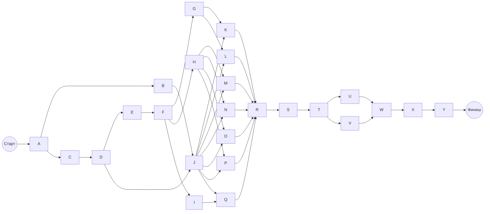
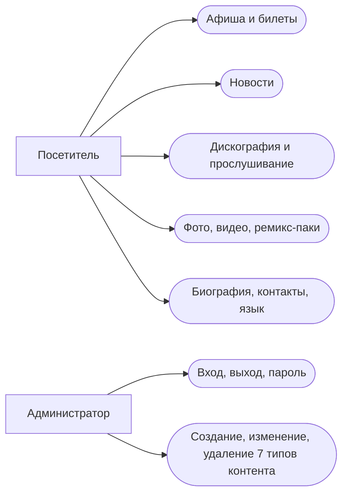

# Материалы к лабораторной работе № 1: maxkorzh.live

Дата исследования: **30 сентября 2026 года**. Это заготовка для переноса в отчёт, а не оформленный отчёт с титульным листом.

Основа структуры: `~/epi1_max/docs/report.docx`, таблица `Набор функциональных требований для разработки проекта.xlsx` и `Сетевая диаграмма.drawio`. Числа рассчитаны заново для сайта Макса Коржа. Идентификаторы A–Y одинаковы в оценках и сетевой модели.

**Основные результаты:** наивная оценка — **1 192 чел.-ч**, PERT — **1 248 чел.-ч**, функциональный размер — **223 UFP**, COCOMO II — **4 054,77 чел.-ч**, UCP — **842,67 чел.-ч** при условной калибровке на AccMarket. Рабочий бюджет — **1 500 чел.-ч**, команда — **2 разработчика**, срок с резервом — **около 24 рабочих недель**.

**Статус исходных данных:** функции публичного сайта проверены по страницам и HTML/JavaScript; закрытая административная часть спроектирована как допущение. История AccMarket проверена, но трудозатраты **760 чел.-ч — учебное допущение, не измеренный факт**. Числовой расчёт UCP завершён условно; для буквального выполнения требования «проект с известными трудозатратами» эту величину надо подтвердить по учёту времени или воспоминаниям участников.

## 1. Объект оценки и границы проекта

### 1.1. Что удалось проверить

Сайт изучался чтением публичных страниц, их HTML и клиентского скрипта. Это не проверка всех действий в реальном браузере; воспроизведение медиа и полный цикл покупки не выполнялись. На части страниц текстовая выдача поискового инструмента скрывала содержимое модальных окон или возвращала устаревший снимок; для афиши и музыкального альбома дополнительно прочитан актуальный HTML.

| Раздел | Наблюдение | Источник |
| --- | --- | --- |
| Главная и навигация | Меню из восьми разделов, RU/EN, ссылки на социальные площадки | [Главная](https://maxkorzh.live/), [EN](https://maxkorzh.live/en/) |
| Концерты | Площадка, город, дата либо открытая дата; выбор предложения через tour_id. В HTML предложения во Франкфурте есть ссылка на maxkorzh.eu | [Афиша](https://maxkorzh.live/kontserty/) |
| Новости | Лента с датами и анонсами, отдельная страница материала | [Лента](https://maxkorzh.live/novosti/), [материал](https://maxkorzh.live/novosti/frankfurt-2026/) |
| Музыка | Каталог релизов; страница альбома содержит audio/source MP3, названия и длительности треков, внешние музыкальные ссылки | [Каталог](https://maxkorzh.live/muzyika/), [альбом](https://maxkorzh.live/muzyika/psychos-hit-the-top/) |
| Фото | Список фотоотчётов и отдельные страницы альбомов | [Фото](https://maxkorzh.live/foto/), [альбом](https://maxkorzh.live/foto/varshava-09.08.2025/) |
| Видео | Каталог клипов; HTML и клиентский скрипт содержат механизм открытия видео | [Видео](https://maxkorzh.live/videos/) |
| Ремикс-пак | Каталог материалов со ссылками скачивания на Google Drive | [Ремикс-паки](https://maxkorzh.live/remixpack/) |
| Биография и контакты | Информационные страницы; контакты разделены по назначению | [Биография](https://maxkorzh.live/obo-mne/), [контакты](https://maxkorzh.live/kontaktyi/) |
| Корзина | Есть надпись и клиентский код корзины. В обследованном основном меню каталог товаров отсутствует; доступный полный сценарий магазина не подтверждён | [Главная](https://maxkorzh.live/), [клиентский скрипт](https://maxkorzh.live/assets/built/js/min/built.js?28.10.2020-5) |

### 1.2. Единый объём для всех методов

Оценивается создание функционального аналога с собственным интерфейсом и простой административной панелью. Целевой стек для расчёта: JavaScript на клиенте и сервере, реляционная БД, файловое/объектное хранилище. Это **проектное решение**, а не утверждение о внутреннем стеке оригинального сайта. Используются обычные библиотеки маршрутизации, работы с БД и медиа; готовая CMS, полностью заменяющая административную часть, не предполагается.

Включены анализ, дизайн, реализация публичных разделов и админки, локальные проверки при разработке, отдельные интеграционные и приёмочные проверки, исправления, небольшое начальное наполнение, инструкция и выпуск. Координация включена в анализ, согласование дизайна, интеграцию и приёмку. Не добавлять поверх этих оценок второй раз фиксированные проценты «за тестирование и управление».

Вне границ: собственная продажа билетов, эквайринг, бронирование мест, магазин мерча, доставка, пользовательские аккаунты поклонников, комментарии, рекомендации, рассылки, полная миграция исторического контента, производство музыки/фото/видео, профессиональные переводы и дальнейшее сопровождение. Внешние музыкальные и билетные площадки не разрабатываются. Для видео принят готовый внешний плеер.

Админка, её вход и изменение пароля — **допущение о необходимом обслуживании контента**, поскольку доступа к исходной CMS нет. Одна роль администратора, учётная запись создаётся при развёртывании; регистрации администраторов и управления ролями в объёме нет. Для всех семи типов контента предусмотрены создание, изменение и удаление. Публикация и снятие с публикации — изменение поля статуса, не отдельный workflow согласования.

## 2. Функциональные требования

Обозначения: **Н** — основано на наблюдаемой публичной функции; **Д** — допущение для нового аналога. Критерии приёмки описывают проектируемую реализацию; наличие каждого граничного состояния у оригинала не утверждается.

| ID | Основа | Требование | Критерий приёмки | Работы |
| --- | --- | --- | --- | --- |
| FR-01 | Н | Открывать главную страницу и разделы через общее меню | Каждый пункт ведёт в нужный раздел; возврат и прямой URL работают | J |
| FR-02 | Н/Д | Переключать RU/EN | Открывается перевод текущего материала; при его отсутствии показано понятное состояние | I, R |
| FR-03 | Н | Показывать афишу | Выведены город, площадка, дата либо признак открытой даты | G, K |
| FR-04 | Н | Открывать предложение по концерту и билетную ссылку | Выбран нужный концерт; доступная ссылка ведёт к внешнему продавцу | K |
| FR-05 | Н | Показывать список новостей | Материал содержит дату, заголовок, обложку и анонс | G, L |
| FR-06 | Н | Открывать полную новость | Текст, изображения и ссылки относятся к выбранному материалу | L |
| FR-07 | Н | Показывать дискографию и релиз | Выводятся обложка, год, тип релиза и список треков | H, M |
| FR-08 | Н/Д | Воспроизводить треки в браузере | Есть play/pause, выбор трека и позиция; одновременно звучит один трек; ошибка загрузки объясняется | M |
| FR-09 | Н | Открывать релиз на внешних музыкальных площадках | Каждая ссылка относится к текущему релизу | M |
| FR-10 | Н/Д | Открывать фотоальбом и просмотрщик | Есть список альбомов, увеличение, переход между фотографиями и закрытие | H, N |
| FR-11 | Н/Д | Выбирать и смотреть видео | Выбранный ролик открывается в готовом плеере; при закрытии воспроизведение останавливается | H, O |
| FR-12 | Н | Открывать ссылку скачивания ремикс-пака | Название соответствует выбранному набору; переход идёт на заданное хранилище | H, P |
| FR-13 | Н | Показывать биографию | Текст и изображения доступны в выбранной локали | I, Q |
| FR-14 | Н | Показывать контакты и социальные ссылки | Контакты разделены по назначению; ссылки кликабельны | I, Q |
| FR-15 | Д | Входить в административную часть и выходить из неё | Без действующей сессии контент менять нельзя; после выхода сессия недействительна | F |
| FR-16 | Д | Изменять пароль администратора | Требуется текущий пароль; неверное подтверждение не сохраняется | F |
| FR-17 | Д | Создавать, изменять и удалять концерты | Проверяются дата/открытая дата и формат билетной ссылки | G |
| FR-18 | Д | Создавать, изменять и удалять новости | Проверяются обязательные поля; черновик не виден публично | G |
| FR-19 | Д | Создавать, изменять и удалять релизы с треками | Сохраняются порядок треков, аудиофайлы и внешние ссылки | H |
| FR-20 | Д | Создавать, изменять и удалять фотоальбомы | Можно загрузить изображения и изменить их порядок/подписи | H |
| FR-21 | Д | Создавать, изменять и удалять карточки видео | Сохраняются название, обложка, год и идентификатор внешнего ролика | H |
| FR-22 | Д | Создавать, изменять и удалять ремикс-паки | Сохраняются название и внешняя ссылка скачивания | H |
| FR-23 | Д | Создавать, изменять и удалять информационные страницы | Один редактор обслуживает биографию, контакты, социальные ссылки и переводы | I |
| FR-24 | Д | Формировать sitemap и выдавать 404 | Карта содержит только опубликованные адреса и языковые альтернативы; отсутствующий URL имеет статус 404 | S |

Дополнительные условия оценки: адаптивные экраны 360–1920 px; проверка актуальных Chrome, Firefox и Safari; клавиатурное управление основными действиями; HTTPS, проверка прав на сервере и типов/размеров файлов; ленивая загрузка изображений; метаданные страниц; резервирование БД и файлов. Это согласованные здесь ориентиры для аналога, не результаты измерения оригинала. Нагрузочный сценарий для V: 100 одновременных посетителей читают каталоги; медиатрафик вынесен в хранилище. Изменение этого предположения требует пересмотра оценки.

## 3. Наивная оценка и PERT

### 3.1. Правила и единицы

Все оценки O, M, P — **человеко-часы**, то есть сумма времени участников, а не календарные часы. O — благоприятный сценарий, M — наиболее вероятный, P — осложнения в пределах того же объёма. Значения — экспертные учебные оценки, не фактические затраты автора сайта.

Наивный метод: `H_naive = ΣM`.

PERT для каждой работы: `t = (O + 4M + P) / 6`; `σ = (P − O) / 6`; `Var = σ²`. При предположении независимости работ: `H_PERT = Σt`, `σ_total = sqrt(ΣVar)`.

### 3.2. Таблица для переноса в Excel и отчёт

Порядок столбцов O–P–M оставлен как в таблице коллеги. Разработка каждого модуля включает его локальную проверку; T–V — проверки взаимодействия и системы целиком.

| ID | Работа | O | P | M | PERT t | σ | Var |
| --- | --- | --- | --- | --- | --- | --- | --- |
| A | Требования и прототипы | 24 | 64 | 40 | 41,33 | 6,67 | 44,44 |
| B | Дизайн экранов и состояний | 48 | 128 | 80 | 82,67 | 13,33 | 177,78 |
| C | Архитектура и модель данных | 24 | 64 | 40 | 41,33 | 6,67 | 44,44 |
| D | Окружение и CI | 16 | 40 | 24 | 25,33 | 4,00 | 16,00 |
| E | Хранилище, API и миграции | 32 | 80 | 48 | 50,67 | 8,00 | 64,00 |
| F | Вход администратора и права | 24 | 72 | 40 | 42,67 | 8,00 | 64,00 |
| G | Админка концертов и новостей | 40 | 104 | 64 | 66,67 | 10,67 | 113,78 |
| H | Админка музыки, фото, видео и паков | 48 | 128 | 80 | 82,67 | 13,33 | 177,78 |
| I | Админка страниц и переводов | 24 | 64 | 40 | 41,33 | 6,67 | 44,44 |
| J | Оболочка, меню, адаптивная вёрстка | 48 | 128 | 80 | 82,67 | 13,33 | 177,78 |
| K | Афиша и выбор билетной ссылки | 32 | 80 | 48 | 50,67 | 8,00 | 64,00 |
| L | Лента и страница новости | 32 | 80 | 48 | 50,67 | 8,00 | 64,00 |
| M | Дискография и аудиоплеер | 64 | 160 | 96 | 101,33 | 16,00 | 256,00 |
| N | Фотоальбомы и просмотрщик | 32 | 80 | 48 | 50,67 | 8,00 | 64,00 |
| O | Видео и внешний плеер | 24 | 64 | 40 | 41,33 | 6,67 | 44,44 |
| P | Ремикс-паки и скачивание | 16 | 40 | 24 | 25,33 | 4,00 | 16,00 |
| Q | Биография, контакты, соцсети | 16 | 40 | 24 | 25,33 | 4,00 | 16,00 |
| R | RU/EN и проверка адаптивности | 24 | 72 | 40 | 42,67 | 8,00 | 64,00 |
| S | SEO, sitemap, 404 | 16 | 40 | 24 | 25,33 | 4,00 | 16,00 |
| T | Интеграционная проверка | 32 | 88 | 48 | 52,00 | 9,33 | 87,11 |
| U | Функциональные и браузерные проверки | 40 | 104 | 64 | 66,67 | 10,67 | 113,78 |
| V | Производительность и защита | 24 | 72 | 40 | 42,67 | 8,00 | 64,00 |
| W | Исправления и приёмка | 32 | 96 | 56 | 58,67 | 10,67 | 113,78 |
| X | Начальное наполнение и инструкция | 16 | 48 | 32 | 32,00 | 5,33 | 28,44 |
| Y | Развёртывание и проверка релиза | 16 | 40 | 24 | 25,33 | 4,00 | 16,00 |
| Итого |  | 744 | 1976 | 1192 | 1 248,00 | 44,18¹ | 1 952,00 |

¹ В строке итога указано `sqrt(ΣVar)`, а не сумма стандартных отклонений.

`H_naive = 1 192 чел.-ч = 149 человеко-дней по 8 часов`.

`H_PERT = 1 248 чел.-ч = 156 человеко-дней`.

`σ_total = sqrt(1 952) = 44,18 чел.-ч`.

При независимости и нормальном приближении ориентировочный двусторонний 95%-интервал суммы: `1 248 ± 1,96 × 44,18 = [1 161,40; 1 334,60] чел.-ч`. Это условный интервал модели, а не гарантия: общие ошибки требований и корреляция работ делают его слишком узким. Поэтому далее принят управленческий резерв 20%, а не обещание уложиться в верхнюю границу этого интервала.

Пример строки M: `(64 + 4 × 96 + 160) / 6 = 101,33 чел.-ч`; дисперсия `((160 − 64)/6)² = 256 чел.-ч²`.

## 4. Сетевая диаграмма, критический путь и команда

### 4.1. Допущения о расписании

Каждую работу выполняет один универсальный специалист; её длительность `d = t / 8` рабочих дней. В исходной CPM-модели независимые работы могут идти параллельно без ограничения числа специалистов. Работа неделима; зависимости finish-to-start, без задержек. Рабочая неделя — 5 дней по 8 часов. Это упрощённая модель: дробление тестирования или ранняя интеграция могут сократить срок, но здесь они не предполагаются.

### 4.2. Диаграмма для перерисовки в draw.io

Названия и длительности узлов — в таблицах. Все зависимости показаны ниже.



### 4.3. Прямой и обратный проход

`ES = max(EF предшественников)`; `EF = ES + d`; `LF = min(LS последователей)`; `LS = LF − d`; полный резерв `TF = LS − ES`. Начало — день 0. В таблице — рабочие дни; округление только для отображения.

| ID | Предшественники | d | ES | EF | LS | LF | TF |
| --- | --- | --- | --- | --- | --- | --- | --- |
| A | — | 5,17 | 0,00 | 5,17 | 0,00 | 5,17 | 0,00 |
| B | A | 10,33 | 5,17 | 15,50 | 14,83 | 25,17 | 9,67 |
| C | A | 5,17 | 5,17 | 10,33 | 5,17 | 10,33 | 0,00 |
| D | C | 3,17 | 10,33 | 13,50 | 10,33 | 13,50 | 0,00 |
| E | D | 6,33 | 13,50 | 19,83 | 13,50 | 19,83 | 0,00 |
| F | E | 5,33 | 19,83 | 25,17 | 19,83 | 25,17 | 0,00 |
| G | F | 8,33 | 25,17 | 33,50 | 33,50 | 41,83 | 8,33 |
| H | F | 10,33 | 25,17 | 35,50 | 25,17 | 35,50 | 0,00 |
| I | F | 5,17 | 25,17 | 30,33 | 39,83 | 45,00 | 14,67 |
| J | B, D | 10,33 | 15,50 | 25,83 | 25,17 | 35,50 | 9,67 |
| K | G, J | 6,33 | 33,50 | 39,83 | 41,83 | 48,17 | 8,33 |
| L | G, J | 6,33 | 33,50 | 39,83 | 41,83 | 48,17 | 8,33 |
| M | H, J | 12,67 | 35,50 | 48,17 | 35,50 | 48,17 | 0,00 |
| N | H, J | 6,33 | 35,50 | 41,83 | 41,83 | 48,17 | 6,33 |
| O | H, J | 5,17 | 35,50 | 40,67 | 43,00 | 48,17 | 7,50 |
| P | H, J | 3,17 | 35,50 | 38,67 | 45,00 | 48,17 | 9,50 |
| Q | I, J | 3,17 | 30,33 | 33,50 | 45,00 | 48,17 | 14,67 |
| R | K, L, M, N, O, P, Q | 5,33 | 48,17 | 53,50 | 48,17 | 53,50 | 0,00 |
| S | R | 3,17 | 53,50 | 56,67 | 53,50 | 56,67 | 0,00 |
| T | S | 6,50 | 56,67 | 63,17 | 56,67 | 63,17 | 0,00 |
| U | T | 8,33 | 63,17 | 71,50 | 63,17 | 71,50 | 0,00 |
| V | T | 5,33 | 63,17 | 68,50 | 66,17 | 71,50 | 3,00 |
| W | U, V | 7,33 | 71,50 | 78,83 | 71,50 | 78,83 | 0,00 |
| X | W | 4,00 | 78,83 | 82,83 | 78,83 | 82,83 | 0,00 |
| Y | X | 3,17 | 82,83 | 86,00 | 82,83 | 86,00 | 0,00 |

Критический путь: **A → C → D → E → F → H → M → R → S → T → U → W → X → Y**.

Длительность критического пути: **86 рабочих дней = 17,2 рабочей недели**. Это нижняя граница календарной длительности в принятой модели, а не 688 чел.-ч суммарного труда проекта. Суммарный труд всех ветвей остаётся **1 248 чел.-ч**.

Для фиксированного критического пути `σ_CP = 4,16 рабочего дня`; смена критического пути при отклонениях и ресурсные конфликты этой величиной не учитываются.

### 4.4. Проверка доступности людей

Одного деления 1 248 на число разработчиков недостаточно. Ниже приведено выполнимое расписание для двух универсальных разработчиков. Интервалы относятся к дням от старта; внутри одного исполнителя они не пересекаются и соблюдают все зависимости.

| Работа | Исполнитель | Начало | Окончание |
| --- | --- | --- | --- |
| A | Р1 | 0,00 | 5,17 |
| C | Р1 | 5,17 | 10,33 |
| B | Р2 | 5,17 | 15,50 |
| D | Р1 | 10,33 | 13,50 |
| E | Р1 | 13,50 | 19,83 |
| J | Р2 | 15,50 | 25,83 |
| F | Р1 | 19,83 | 25,17 |
| H | Р1 | 25,17 | 35,50 |
| G | Р2 | 25,83 | 34,17 |
| I | Р2 | 34,17 | 39,33 |
| M | Р1 | 35,50 | 48,17 |
| K | Р2 | 39,33 | 45,67 |
| L | Р2 | 45,67 | 52,00 |
| N | Р1 | 48,17 | 54,50 |
| O | Р2 | 52,00 | 57,17 |
| P | Р1 | 54,50 | 57,67 |
| Q | Р2 | 57,17 | 60,33 |
| R | Р1 | 60,33 | 65,67 |
| S | Р1 | 65,67 | 68,83 |
| T | Р1 | 68,83 | 75,33 |
| U | Р1 | 75,33 | 83,67 |
| V | Р2 | 75,33 | 80,67 |
| W | Р1 | 83,67 | 91,00 |
| X | Р1 | 91,00 | 95,00 |
| Y | Р1 | 95,00 | 98,17 |

Ресурсное расписание построено жадным выбором готовой работы с наибольшим оставшимся путём. Это допустимый план, **не доказанный глобальный оптимум**.

| Число разработчиков | Полученный срок, раб. дни | Недели | Вывод |
| --- | --- | --- | --- |
| 1 | 156,00 | 31,20 | Последовательное выполнение |
| 2 | 98,17 | 19,63 | Практический баланс срока и состава |
| 3 | 86,67 | 17,33 | Экономит около 11,5 дня против двух, затем ограничивают зависимости |

Рекомендуются **два разработчика**, один с упором на сервер и данные, другой — на интерфейс и медиа; в расписании оба могут брать задачи смежного направления. Дизайн, тестирование и выпуск совмещаются, их время уже включено. Если нужны отдельные дизайнер/QA, надо перераспределить этот же труд, а не автоматически добавить полные ставки.

С резервом: `98,17 × 1,20 = 117,80 рабочего дня ≈ 23,56 недели`. Округлённый план — **24 рабочие недели (примерно 5,5–6 календарных месяцев без уточнения праздников)**. Это не результат деления 1 500 на 2 × 40: на последовательных этапах второй участник не загружен полностью. Третьего постоянного разработчика экономически не обосновываем; при жёстком сроке полезнее временно помочь с независимыми модулями.

## 5. Метод функциональных точек

### 5.1. Граница и правила счёта

Граница приложения включает публичный сайт, собственную админку, API, БД и медиахранилище. Контент разбит на логические пользовательские группы, а не на физические таблицы. DET — уникальное различимое поле, RET — подгруппа записей, FTR — логический файл, который читает или меняет транзакция. Переводы и отдельные треки не умножают число функций на количество записей.

Это предварительная оценка по проектируемым требованиям, не сертифицированный подсчёт существующего приложения. Состав данных и транзакций зафиксирован ниже, чтобы его можно было уточнить после проектирования.

Веса Low / Average / High: ILF — 7/10/15; EIF — 5/7/10; EI — 3/4/6; EO — 4/5/7; EQ — 3/4/6. Для используемых сочетаний: ILF с 1–5 RET и DET < 20 — Low; EI с 2 FTR и 5–15 DET — Average, с 2 FTR и 1–4 DET — Low; EQ с 1 FTR и до 19 DET — Low; EQ с ≥3 FTR и 6–19 DET — High. Таблицы весов приведены в [руководстве COCOMO II, раздел 2.2](https://www.cs.otago.ac.nz/cosc345/resources/COCOMO-II-2000.pdf).

### 5.2. Внутренние логические файлы

Поля ниже — модель аналога. ID, статус и локаль учитываются, если различимы пользователю; технические внутренние ключи сверх этой модели не добавляются. Название и текст другой локали — записи той же структуры.

| ID | ILF | RET | DET | Состав полей | Сложность | FP |
| --- | --- | --- | --- | --- | --- | --- |
| D1 | Концерты | 2 | 12 | ID, название, город, страна, площадка, дата, время, открытая дата, статус, локаль, продавец, URL билета | Low | 7 |
| D2 | Новости | 1 | 10 | ID, заголовок, slug, анонс, текст, дата, обложка, alt, статус, локаль | Low | 7 |
| D3 | Релизы и треки | 2 | 18 | ID релиза, название, slug, тип, год, обложка, alt, статус, локаль, ID трека, название трека, номер, длительность, аудиофайл, подпись ссылки, URL площадки, описание, дата публикации | Low | 7 |
| D4 | Фотоальбомы и фотографии | 2 | 14 | ID альбома, название, slug, дата, место, описание, обложка, статус, локаль, ID фото, файл, подпись, alt, порядок | Low | 7 |
| D5 | Видео | 1 | 9 | ID, название, год, обложка, alt, провайдер, ID/URL ролика, статус, локаль | Low | 7 |
| D6 | Ремикс-паки | 1 | 7 | ID, название, описание, обложка, URL скачивания, статус, локаль | Low | 7 |
| D7 | Информационные страницы | 2 | 13 | ID, тип страницы, slug, заголовок, текст, изображение, alt, статус, локаль, тип контакта, подпись контакта/ссылки, значение/URL, порядок | Low | 7 |
| D8 | Администраторы | 1 | 4 | ID, логин, пароль (логическое поле), признак активности | Low | 7 |
| Итого |  |  |  |  |  | 56 |

Пароль хранится как хеш; это не второе пользовательское поле. Картинки и аудиофайлы входят в соответствующие группы контента, отдельный пользовательский файловый менеджер не предусмотрен. Информационные страницы — один тип редактора, контакты/ссылки — его повторяющаяся подгруппа.

**EIF = 0.** Ссылки на Google Drive, билетного продавца, музыкальные сервисы и внешний видеоплеер не означают чтение самостоятельной внешней логической базы данных. API-импорт их каталогов отсутствует.

### 5.3. Входы EI

У каждой операции записи два FTR: соответствующий контент D1–D7 и D8 для проверки доступа. Вводимые поля — подмножество ILF; ID/служебно отображаемые значения не требуют повторного ручного ввода. В DET транзакции учитывается управляющее действие/сообщение по принятой модели. Границы сложности остаются одинаковыми для создания и изменения.

| Объект | Создание: DET / FP | Изменение: DET / FP | Удаление: DET / FP | Всего FP |
| --- | --- | --- | --- | --- |
| D1 Концерт | 12 / 4 | 13 / 4 | 3 / 3 | 11 |
| D2 Новость | 10 / 4 | 11 / 4 | 3 / 3 | 11 |
| D3 Релиз с треками | 14 / 4 | 15 / 4 | 3 / 3 | 11 |
| D4 Фотоальбом | 13 / 4 | 14 / 4 | 3 / 3 | 11 |
| D5 Видео | 9 / 4 | 10 / 4 | 3 / 3 | 11 |
| D6 Ремикс-пак | 7 / 4 | 8 / 4 | 3 / 3 | 11 |
| D7 Информационная страница | 14 / 4 | 15 / 4 | 3 / 3 | 11 |

У релиза в форме редактируются название, slug, тип, год, обложка, alt, статус, локаль, название трека, порядок, аудиофайл, подпись/URL площадки и управляющее действие. Длительность извлекается из аудиофайла; ID и дата выдаются системой. Это объясняет разницу DET файла и ввода. Для альбома повторение строки фотографии не добавляет новых типов DET.

| Дополнительная EI | FTR | DET | Сложность | FP |
| --- | --- | --- | --- | --- |
| Вход администратора | D8 | 3 | Low | 3 |
| Выход / завершение сессии | D8 | 1 | Low | 3 |
| Изменение пароля | D8 | 4 | Low | 3 |

**Итого EI: 14 Average × 4 + 10 Low × 3 = 86 FP (24 операции).** Сессия — управляющее состояние, не отдельный бизнес-файл. Загрузка медиа, переводы и статус публикации входят в соответствующее создание/изменение, повторно не считаются.

### 5.4. Запросы EQ и выходы EO

| Запрос | Количество | FTR | DET на запрос | Сложность | FP суммарно |
| --- | --- | --- | --- | --- | --- |
| Афиша и отдельное предложение концерта | 2 | D1 | 8; 7 | Low | 6 |
| Лента и полная новость | 2 | D2 | 6; 10 | Low | 6 |
| Дискография и релиз с треками | 2 | D3 | 6; 18 | Low | 6 |
| Список фотоальбомов и альбом | 2 | D4 | 7; 14 | Low | 6 |
| Каталог видео | 1 | D5 | 9 | Low | 3 |
| Каталог ремикс-паков | 1 | D6 | 7 | Low | 3 |
| Информационная страница выбранного типа/локали | 1 | D7 | 13 | Low | 3 |
| Административные списки D1–D7 | 7 | Один соответствующий D1–D7 | 5–8 | Low | 21 |
| Получение объекта для формы редактирования D1–D7 | 7 | Один соответствующий D1–D7 | 7–18 | Low | 21 |
| Sitemap с языковыми альтернативами | 1 | D1–D7 | 6 | High | 6 |

В запросах админки предполагается проверка уже выданной подписанной сессии без чтения D8, поэтому FTR = 1. В операциях записи дополнительно проверяется активность учётной записи. Это явно принятое архитектурное допущение.

Шесть DET sitemap: URL, lastmod, changefreq, priority, hreflang и URL языковой альтернативы. Это извлечение/форматирование хранимых данных без расчётных бизнес-показателей. Поэтому здесь EQ, а не EO. Параметры changefreq/priority заданы конфигурацией; при иной реализации границу DET нужно пересмотреть (в частности, 4 DET дали бы Average и 4 FP).

**Итого EQ: 25 Low × 3 + 1 High × 6 = 81 FP (26 запросов). EO = 0**: отчётов с вычисляемыми бизнес-данными нет. Вывод HTML сам по себе не означает EO. Управление play/pause и переключением кадров не является дополнительной серверной бизнес-транзакцией; оно увеличивает труд WBS и сложность UCP. Статические меню и 404 не добавляют самостоятельный FP за каждый экран.

### 5.5. Итог и учебная поправка VAF

`UFP = ILF + EIF + EI + EO + EQ = 56 + 0 + 86 + 0 + 81 = 223`.

Для сопоставления с формой отчёта коллеги приводится историческая поправка VAF. Оценки ниже — наши допущения об аналоге, по шкале 0–5.

| № | Характеристика | DI |
| --- | --- | --- |
| 1 | Обмен данными | 3 |
| 2 | Распределённая обработка | 1 |
| 3 | Производительность | 3 |
| 4 | Ограничения оборудования | 1 |
| 5 | Интенсивность транзакций | 2 |
| 6 | Интерактивный ввод | 4 |
| 7 | Удобство пользователя | 4 |
| 8 | Обновление онлайн | 3 |
| 9 | Сложная обработка | 2 |
| 10 | Повторное использование | 2 |
| 11 | Установка | 3 |
| 12 | Эксплуатация | 3 |
| 13 | Несколько площадок | 2 |
| 14 | Изменяемость | 4 |
|  | Сумма | 37 |

`VAF = 0,65 + 0,01 × 37 = 1,02`; `AFP = 223 × 1,02 = 227,46`.

**В COCOMO II далее передаются 223 UFP, а не 227,46 AFP**, поскольку факторы модели уже учитывают характеристики проекта. AFP дан отдельно для совместимости со структурой шаблона.

## 6. COCOMO II

### 6.1. Преобразование размера

Используется **COCOMO II.2000, Early Design**, поскольку подробной архитектуры и статистики завершённых аналогичных проектов нет. Это семь множителей Early Design, не неполная смесь с Post-Architecture.

Для выбранного JavaScript-стека [QSM Function Point Languages Table](https://www.qsm.com/resources/function-point-languages-table) даёт **Average = 47 SLOC/FP**, Median = 53, диапазон 31–63. Берём среднее 47. React/Vue — библиотеки, отдельного коэффициента «строк React» не вводим. Библиотечный код, зависимости, сгенерированные файлы и медиа не включаются в новый написанный код.

`SLOC = 223 × 47 = 10 481`; `KSLOC = 10,481`.

Это статистическое преобразование функционального размера, а не фактически измеренный объём исходников. Для другого языка или CMS коэффициент и модель повторного использования надо заменить.

### 6.2. Факторы масштаба

Коэффициенты и формулы взяты из [COCOMO II Model Definition Manual v2.1, таблицы 10 и 63](https://www.cs.otago.ac.nz/cosc345/resources/COCOMO-II-2000.pdf). Уровни выбраны для нашего сценария.

| Фактор | Уровень | SF | Причина выбора |
| --- | --- | --- | --- |
| PREC | High | 2,48 | Типичный контентный сайт, известные способы реализации |
| FLEX | High | 2,03 | Допускается собственный дизайн при сохранении функций |
| RESL | Nominal | 4,24 | Состав определён, медиа и браузерные риски требуют проверки |
| TEAM | Nominal | 3,29 | Обычная совместная работа небольшой команды |
| PMAT | Nominal | 4,68 | Принят базовый упорядоченный процесс без предположения высокой зрелости |
| Итого |  | 16,72 |  |

`E = B + 0,01 × ΣSF = 0,91 + 0,1672 = 1,0772`. Значение PMAT — допущение модели, не подтверждённый уровень зрелости реальной команды.

### 6.3. Множители трудоёмкости

| Фактор | Уровень | EM | Причина выбора |
| --- | --- | --- | --- |
| PERS | Nominal | 1,00 | Не предполагается исключительная квалификация |
| RCPX | Low | 0,83 | Контентный продукт без расчётов платежей и сложных алгоритмов |
| PDIF | Nominal | 1,00 | Обычная веб-платформа |
| PREX | Nominal | 1,00 | Умеренный опыт выбранного стека |
| FCIL | High | 0,87 | Готовые средства разработки, CI и совместной работы |
| RUSE | Nominal | 1,00 | Нет отдельного требования выпускать универсальную платформу |
| SCED | Nominal | 1,00 | Принудительное сжатие срока отсутствует |

`EAF = ΠEM = 0,83 × 0,87 = 0,7221`.

### 6.4. Трудоёмкость и срок

`PM = 2,94 × KSLOC^E × EAF`

`PM = 2,94 × 10,481^1,0772 × 0,7221 = 26,676109 чел.-мес`.

Номинальный месяц модели — **152 чел.-ч**: `H_COCOMO = 26,676109 × 152 = 4 054,77 чел.-ч`. В расписании WBS используется 8-часовой день, а здесь нормативная единица самой модели; человеко-часы позволяют сравнить результаты без смешения месяцев.

Для SCED = 1: `F = 0,28 + 0,2 × (E − 0,91) = 0,31344`; `TDEV = 3,67 × PM^F = 10,27 месяца`; средняя численность `PM/TDEV ≈ 2,60 человека`.

Это отдельный модельный прогноз срока; его нельзя подставлять вместо срока ресурсного расписания PERT. Константа A = 2,94 относится к калибровке модели, а не просто к «современным языкам».

Не добавляем поверх результата ещё 25–40% автоматически: модель уже содержит разработку, проектирование и проверки в своём жизненном цикле. Границы раннего исследования и ввода в эксплуатацию между моделями не абсолютно одинаковы; здесь COCOMO используется как приближённая независимая проверка инженерного бюджета, без попытки получить точность до часа.

### 6.5. Чувствительность

| SLOC/FP | KSLOC | Труд, чел.-ч |
| --- | --- | --- |
| 31 | 6,913 | 2 589,86 |
| 47 | 10,481 | 4 054,77 |
| 63 | 14,049 | 5 559,45 |

Этот диапазон меняет **только** коэффициент перевода, оставляя 223 UFP, E и EAF постоянными; это не статистический доверительный интервал. Такой разброс показывает, почему коэффициент из отраслевой выборки нельзя считать точным измерением небольшого сайта.

## 7. Use Case Points

### 7.1. Общие правила

Принята версия UCP из исследования [Anda et al., Estimating Software Development Effort Based on Use Cases — Experiences from Industry](https://www.researchgate.net/publication/220868555_Estimating_Software_Development_Effort_Based_on_Use_Cases_-_Experiences_from_Industry). В ней вес T2 равен **2**; встречаются таблицы с весом 1. Здесь одна и та же версия применяется к обоим проектам.

Вес сценария: до 3 транзакций — 5; 4–7 — 10; от 8 — 15. Транзакция — содержательный шаг взаимодействия пользователя и системы, включая существенные альтернативы; не каждое внутреннее обращение к БД. Акторы GUI имеют вес 3, протокольная внешняя система — 2, внешний программный API — 1. Не считать один и тот же сервис и актором API, и человеком.

`UUCP = UUCW + UAW`; `TCF = 0,6 + 0,01 × Σ(Ti × Wi)`; `ECF = 1,4 − 0,03 × Σ(Ei × Wi)`; `UCP = UUCP × TCF × ECF`; `H = UCP × PF`.

### 7.2. Сценарии сайта

| ID | Сценарий | Актор | Транзакций | Вес | Содержание |
| --- | --- | --- | --- | --- | --- |
| UC-01 | Просмотр афиши | Посетитель | 2 | 5 | Открыть афишу → получить список |
| UC-02 | Выбор билетного предложения | Посетитель | 3 | 5 | Выбрать концерт → получить предложения → перейти к продавцу |
| UC-03 | Чтение новости | Посетитель | 3 | 5 | Открыть ленту → выбрать материал → вернуться |
| UC-04 | Просмотр дискографии и релиза | Посетитель | 3 | 5 | Открыть каталог → выбрать релиз → открыть внешнюю площадку |
| UC-05 | Прослушивание музыки | Посетитель | 5 | 10 | Выбрать трек → play/pause → перемотать → сменить трек → обработать ошибку загрузки |
| UC-06 | Просмотр фотографий | Посетитель | 4 | 10 | Выбрать альбом → увеличить фото → перейти к другому → закрыть |
| UC-07 | Просмотр видео | Посетитель | 3 | 5 | Выбрать ролик → воспроизвести → закрыть |
| UC-08 | Получение ремикс-пака | Посетитель | 2 | 5 | Выбрать набор → открыть скачивание |
| UC-09 | Чтение биографии | Посетитель | 1 | 5 | Открыть страницу |
| UC-10 | Получение контактов | Посетитель | 2 | 5 | Открыть контакты → воспользоваться ссылкой |
| UC-11 | Смена языка | Посетитель | 2 | 5 | Выбрать язык → получить перевод/состояние отсутствия |
| UC-12 | Вход в админку | Администратор | 3 | 5 | Открыть форму → отправить данные → исправить ошибку при отказе |
| UC-13 | Выход из админки | Администратор | 1 | 5 | Завершить сессию |
| UC-14 | Изменение пароля | Администратор | 3 | 5 | Открыть форму → отправить → исправить ошибку при отказе |

Следующие строки раскрывают ещё **21 отдельный сценарий**, а не семь укрупнённых «управлений». Для каждого типа: создание — открыть форму, сохранить, исправить ошибку (3 транзакции); изменение — выбрать запись, сохранить изменения, исправить ошибку (3); удаление — выбрать, подтвердить удаление (2). Статус и локаль меняются в том же сценарии редактирования. Повторение строк треков/фотографий в форме не создаёт новый независимый сценарий.

| Тип контента | Создание, ID / вес | Изменение, ID / вес | Удаление, ID / вес | Сумма |
| --- | --- | --- | --- | --- |
| Концерты | UC-15 / 5 | UC-16 / 5 | UC-17 / 5 | 15 |
| Новости | UC-18 / 5 | UC-19 / 5 | UC-20 / 5 | 15 |
| Релизы | UC-21 / 5 | UC-22 / 5 | UC-23 / 5 | 15 |
| Фотоальбомы | UC-24 / 5 | UC-25 / 5 | UC-26 / 5 | 15 |
| Видео | UC-27 / 5 | UC-28 / 5 | UC-29 / 5 | 15 |
| Ремикс-паки | UC-30 / 5 | UC-31 / 5 | UC-32 / 5 | 15 |
| Информационные страницы | UC-33 / 5 | UC-34 / 5 | UC-35 / 5 | 15 |

Всего **35 сценариев: 33 простых и 2 средних**. `UUCW = 33 × 5 + 2 × 10 = 185`.

Акторы: посетитель (GUI, 3) и администратор (GUI, 3), `UAW = 6`. Внешние сайты по обычным ссылкам не добавляются как участники программного обмена. Готовый видеоплеер находится вне реализуемого приложения; собственной интеграции с его API не требуется. Sitemap рассматривается как инфраструктурная выдача в существующем сценарии публикации, не отдельная человеческая цель. Эта разница гранулярности FPA и UCP отмечена явно.

Диаграмма ниже — группировка для переноса в отчёт; отдельные сценарии для счёта перечислены в таблицах.



### 7.3. Технические факторы обоих проектов

Оценки 0–5. В колонках «сайт» и «AccMarket» сначала дана оценка, затем её вклад с весом. Все оценки — аналитические допущения. Для AccMarket оценивается учебная реализация, а не промышленная торговая платформа.

| Фактор | Название | Вес | Сайт: оценка | Сайт: вклад | AccMarket: оценка | AccMarket: вклад |
| --- | --- | --- | --- | --- | --- | --- |
| T1 | Распределённость | 2 | 2 | 4,00 | 2 | 4,00 |
| T2 | Отклик / пропускная способность | 2 | 3 | 6,00 | 2 | 4,00 |
| T3 | Эффективность работы пользователя | 1 | 3 | 3,00 | 3 | 3,00 |
| T4 | Внутренняя обработка | 1 | 2 | 2,00 | 3 | 3,00 |
| T5 | Переиспользуемость | 1 | 2 | 2,00 | 2 | 2,00 |
| T6 | Установка | 0.5 | 3 | 1,50 | 3 | 1,50 |
| T7 | Удобство использования | 0.5 | 5 | 2,50 | 4 | 2,00 |
| T8 | Переносимость | 2 | 3 | 6,00 | 2 | 4,00 |
| T9 | Удобство изменений | 1 | 4 | 4,00 | 3 | 3,00 |
| T10 | Параллельность | 1 | 2 | 2,00 | 3 | 3,00 |
| T11 | Безопасность | 1 | 3 | 3,00 | 4 | 4,00 |
| T12 | Программный доступ третьих сторон | 1 | 0 | 0,00 | 0 | 0,00 |
| T13 | Специальное обучение | 1 | 1 | 1,00 | 2 | 2,00 |
|  | Сумма |  |  | 37,00 |  | 35,50 |

Для сайта важны медиа, мобильные экраны и обновление контента; сложная вычислительная логика не требуется. У AccMarket выше требования к проверке операций и доступу к данным, но учебные требования к нагрузке и переносимости скромнее. T12 = 0 означает отсутствие отдельного публичного API для независимых партнёров; открытый сайт сам по себе не делает этот фактор максимальным.

`TCF_site = 0,97`; `TCF_AccMarket = 0,955`.

### 7.4. Факторы окружения обоих проектов

| Фактор | Название | Вес | Сайт: оценка | Сайт: вклад | AccMarket: оценка | AccMarket: вклад |
| --- | --- | --- | --- | --- | --- | --- |
| E1 | Знакомство с процессом разработки | 1.5 | 3 | 4,50 | 2 | 3,00 |
| E2 | Опыт предметной области | 0.5 | 3 | 1,50 | 2 | 1,00 |
| E3 | Опыт объектного проектирования | 1 | 3 | 3,00 | 2 | 2,00 |
| E4 | Способности ведущего аналитика | 0.5 | 3 | 1,50 | 3 | 1,50 |
| E5 | Мотивация | 1 | 4 | 4,00 | 4 | 4,00 |
| E6 | Стабильность требований | 2 | 4 | 8,00 | 3 | 6,00 |
| E7 | Частичная занятость | -1 | 1 | -1,00 | 3 | -3,00 |
| E8 | Сложность языка для команды | -1 | 1 | -1,00 | 2 | -2,00 |
|  | Сумма |  |  | 20,50 |  | 12,50 |

Для нового сайта предполагается более знакомая предметная область, закреплённый объём и преимущественная занятость проектом. Для учебного AccMarket — обучение в процессе и работа параллельно учёбе. Это объясняет отличие коэффициентов; история Git сама по себе эти баллы не доказывает. Отрицательные веса E7/E8 сохранены.

`ECF_site = 1,4 − 0,03 × 20,5 = 0,785`.

`ECF_AccMarket = 1,4 − 0,03 × 12,5 = 1,025`.

### 7.5. Размер сайта

`UCP_site = (185 + 6) × 0,97 × 0,785 = 145,43695 UCP`.

**UCP — условные точки, не человеко-часы.** Перевод в труд выполняется только после калибровки PF.

## 8. Калибровка PF по AccMarket

### 8.1. Проверенные факты репозитория

Проект: [listoCheck/AccMarket](https://github.com/listoCheck/AccMarket), курсовая по информационным системам. Исследована версия [`f10a7ed1c2f443c9b93571dac3309584a9d92b43`](https://github.com/listoCheck/AccMarket/commit/f10a7ed1c2f443c9b93571dac3309584a9d92b43).

История достижимых коммитов HEAD совпала с `--all`: **105 коммитов**, из них **93 без merge** и **12 merge**. По датам авторства, приведённым к Москве: от **06.09.2025** до **17.01.2026**, **134 календарных дня включительно**, **35 дат с коммитами**. Имена авторов: artem, ArtemAmuz, Mikhail Trikashnyi, trikesh, Mikki. Это пять Git-идентичностей, не доказательство пяти разных людей.

Контрольные вехи:

| Дата | Коммит | Наблюдение |
| --- | --- | --- |
| 06.09.2025 | [174eb40](https://github.com/listoCheck/AccMarket/commit/174eb40) | Первый backend-коммит |
| 27.09.2025 | [2d2ad90](https://github.com/listoCheck/AccMarket/commit/2d2ad90) | ER и модель данных |
| 02.11.2025 | [0112a8c](https://github.com/listoCheck/AccMarket/commit/0112a8c) | Сервис авторизации |
| 04.11.2025 | [02f5a78](https://github.com/listoCheck/AccMarket/commit/02f5a78) | Логика объявлений |
| 06.11.2025 | [b5953d4](https://github.com/listoCheck/AccMarket/commit/b5953d4) | Тесты авторизации |
| 11.12.2025 | [6419fa2](https://github.com/listoCheck/AccMarket/commit/6419fa2) | Работа над frontend |
| 02.01.2026 | [3e1b1ab](https://github.com/listoCheck/AccMarket/commit/3e1b1ab) | Модерация, баланс, уведомления |
| 12.01.2026 | [a31aa39](https://github.com/listoCheck/AccMarket/commit/a31aa39) | Исправление баланса при покупке |
| 17.01.2026 | [f10a7ed](https://github.com/listoCheck/AccMarket/commit/f10a7ed) | Слияние frontend |

Код подтверждает Kotlin/Spring на сервере и **Vue** на клиенте; значок React в README устарел относительно исследованного дерева. Функции проверены по контроллерам/сервисам и `frontend/src/router/index.js`. Проект не запускался; наличие кода не равно доказательству безошибочной работы или производственной готовности.

В UCP включены реализованные регистрация/вход, объявления, покупка, кабинеты, учебный баланс, модерация, апелляции, уведомления и роли. Не включены как отдельные готовые функции аренда с автоматическим отзывом доступа, интеграция Steam, настоящий банковский эквайринг и финансовый аудит: наличие их в первоначальных планах не подтверждает реализацию. Deposit/withdraw в `BalanceService` изменяют баланс внутри приложения.

### 8.2. Сценарии AccMarket

Обозначения путей в последнем столбце относятся к `src/main/kotlin/com/example/accmarket/` в зафиксированном коммите. Числа транзакций — реконструкция сценариев по коду с той же гранулярностью, что для сайта.

| ID | Сценарий | Транзакций | Вес | Шаги | Основание |
| --- | --- | --- | --- | --- | --- |
| AC-01 | Регистрация | 3 | 5 | Открыть форму; отправить; исправить отказ | auth/controller/UserController.kt |
| AC-02 | Вход | 3 | 5 | Открыть форму; отправить; исправить отказ | auth/controller/UserController.kt |
| AC-03 | Выход | 1 | 5 | Завершить сессию | auth/controller/UserController.kt |
| AC-04 | Каталог и фильтрация | 3 | 5 | Получить список; задать фильтры; сменить страницу | core/controller/AdvertisementController.kt |
| AC-05 | Создание объявления | 3 | 5 | Открыть форму; отправить; исправить отказ | core/controller/AdvertisementController.kt |
| AC-06 | Редактирование объявления | 3 | 5 | Выбрать; сохранить; исправить отказ | core/controller/AdvertisementController.kt |
| AC-07 | Удаление объявления | 2 | 5 | Выбрать; подтвердить | core/controller/AdvertisementController.kt |
| AC-08 | Просмотр своих объявлений | 2 | 5 | Открыть кабинет; выбрать страницу списка | core/controller/AdvertisementController.kt |
| AC-09 | Покупка | 5 | 10 | Выбрать; купить; получить данные; ветка недостаточного баланса; ветка недоступного объявления | core/service/AdvertisementService.kt |
| AC-10 | Просмотр покупок | 2 | 5 | Открыть покупки; получить данные аккаунта | core/controller/AdvertisementController.kt |
| AC-11 | Просмотр баланса | 1 | 5 | Запросить баланс | balance/controller/BalanceController.kt |
| AC-12 | Учебное пополнение | 2 | 5 | Отправить сумму; исправить некорректную сумму | balance/service/BalanceService.kt |
| AC-13 | Учебное списание | 2 | 5 | Отправить сумму; обработать отказ | balance/service/BalanceService.kt |
| AC-14 | Чтение уведомлений | 3 | 5 | Получить список; выбрать непрочитанные; отметить прочитанными | notification/controller/NotificationController.kt |
| AC-15 | Подача апелляции | 3 | 5 | Выбрать отклонённое объявление; отправить причину; исправить отказ | moderation/service/AppealService.kt |
| AC-16 | Очередь апелляций | 1 | 5 | Получить ожидающие решения | moderation/controller/AppealController.kt |
| AC-17 | Решение по апелляции | 4 | 10 | Выбрать; просмотреть; отправить решение; обработать повторное решение | moderation/service/AppealService.kt |
| AC-18 | Очередь модерации | 2 | 5 | Получить список; выбрать объявление | admin/controller/AdminController.kt |
| AC-19 | Модерация объявления | 4 | 10 | Выбрать; получить сведения; отправить решение; получить итог/ошибку | moderation/controller/ModerationController.kt |
| AC-20 | Управление ролями | 4 | 10 | Получить пользователей; просмотреть роли; изменить/назначить; обработать отказ | admin/controller/AdminController.kt |

`UUCW_AccMarket = 16 × 5 + 4 × 10 = 120`.

Акторы: гость, зарегистрированный пользователь (покупатель и продавец — одна роль с доступом к обеим операциям), модератор, администратор — четыре GUI-актора по 3. Почтовый сервер SMTP — протокольный актор, вес 2. Итого `UAW_AccMarket = 4 × 3 + 2 = 14`. БД, JWT и внутренние сервисы акторами не являются. Отправка уведомлений встроена в бизнес-сценарии; отдельный сценарий «автоматическая отправка письма» второй раз не добавлен.

`UCP_AccMarket = (120 + 14) × 0,955 × 1,025 = 131,16925`.

### 8.3. Откуда берутся часы

По коммитам нельзя вычислить фактические рабочие часы: работа могла идти без коммитов, несколько коммитов могли занимать минуты, а большой интервал включать дни без работы. Поэтому **не используем** ни разность времени первого и последнего коммита как человеко-часы, ни правило «один коммит = N часов».

Для законченного учебного примера принимаем согласованное допущение: **2 участника × 19 активных учебных недель × 20 часов в неделю = 760 чел.-ч суммарно**. 134 календарных дня дают примерно 19 недель, но активность каждой недели и число участников такой формулой не доказываются. Это сценарий реконструкции, а не статистика Git. Время включает анализ, реализацию, исправления, проверки и документацию всей команды. Одни личные часы backend-разработчика нельзя делить на UCP всего frontend+backend проекта.

Вариант текста для отчёта, сохраняющий честный статус данных:

> Для калибровки выбран ранее разработанный учебный проект AccMarket. Его состав восстановлен по исходному коду, период — по истории Git. Из-за отсутствия табеля суммарные трудозатраты приняты оценочно равными 760 человеко-часам. Поэтому полученный PF является условной калибровкой; результат UCP следует уточнить после подтверждения фактического времени участников.

Если преподаватель требует именно известные, а не оценочные затраты, это допущение надо заменить реальными данными; разрешение использовать учебные предположения не делает часы измеренными.

### 8.4. PF и перенос на сайт

`PF = H_AccMarket / UCP_AccMarket = 760 / 131,16925 = 5,794040905 чел.-ч/UCP`.

`H_UCP = 145,43695 × 5,794040905 = 842,667637 ≈ 842,67 чел.-ч`.

Дополнительная `CONST` не добавляется: принятые 760 часов уже охватывают полный учебный цикл. Если выяснится, что они относятся только к кодированию, сравнение надо перестроить, а не молча добавлять произвольные 220 часов из чужого отчёта.

Обновление после уточнения часов особенно простое:

`H_UCP_site = (145,43695 / 131,16925) × H_AccMarket ≈ 1,108773 × H_AccMarket`.

| Предполагаемый труд AccMarket | PF, чел.-ч/UCP | Труд сайта, чел.-ч |
| --- | --- | --- |
| 570 | 4,35 | 632,00 |
| 760 | 5,79 | 842,67 |
| 950 | 7,24 | 1053,33 |

Это чувствительность к ±25% исходных часов, не доверительный интервал. Переход от учебной торговой системы к публичному медиасайту также ограничивает переносимость PF: другой интерфейс, стек, качество визуальной реализации и требования к эксплуатации.

## 9. Сопоставление и окончательная оценка

| Метод | Труд, чел.-ч | Что определяет результат |
| --- | --- | --- |
| Наивный | 1 192,00 | Сумма наиболее вероятных оценок работ |
| PERT | 1 248,00 | Те же работы с трёхточечной оценкой |
| FP + COCOMO II | 4 054,77 | 223 UFP, 47 SLOC/FP, некалиброванная отраслевая модель |
| UCP | 842,67 | 145,43695 UCP и условный PF по AccMarket |
| Принятый бюджет | 1 500,00 | PERT + 20% резерва с округлением |

### 9.1. Почему результаты различаются

Наивная оценка и PERT близки, потому что используют одну декомпозицию. PERT выше примерно на 4,7% из-за асимметрии оптимистичных и пессимистичных оценок; это не независимая проверка точности.

COCOMO II выше PERT примерно в 3,25 раза. FPA учитывает отдельные операции создания, изменения, удаления и чтения, а реализация типовых редакторов разделяет формы и общие компоненты. Перевод функциональных точек в строки и далее в труд по отраслевой модели не отражает эту конкретную производительность. Это **возможное объяснение**, не доказательство, что COCOMO ошибочна. Разница означает также риск оптимизма WBS. Даже нижний сценарий QSM даёт около 2 590 часов, поэтому расхождение нельзя скрыть округлением.

UCP ниже PERT примерно на 32,5%. Его слабое место — условные 760 часов, перенос PF с учебного проекта и чувствительность к гранулярности сценариев. Сам по себе небольшой результат не подтверждает высокую производительность команды. С другой стороны, COCOMO нельзя автоматически объявить самой точной только потому, что это формализованная модель.

### 9.2. Решение о трудозатратах

Для зафиксированного ограниченного аналога принимается **1 500 чел.-ч**:

`1 248 × 1,20 = 1 497,60 → 1 500 чел.-ч`.

Основа — проверяемые пакеты работ, простой контентный backend, отсутствие собственной торговли и ограниченное наполнение. Это **рабочая плановая оценка**, а не доказанный фактический бюджет. Резерв 252 часа предназначен для уточнения требований, браузерных особенностей плеера, дополнительных исправлений и интеграции. 1 500 часов — 187,5 человеко-дня, но календарный план для двух участников с учётом зависимостей составляет примерно **24 рабочие недели**.

Из-за расхождения с COCOMO после реализации первых вертикальных срезов — афиши с админкой и релиза с плеером — следует сравнить фактические часы с G/K и H/M, уточнить общие компоненты и пересчитать оставшиеся работы. Если заказчик потребует магазин, внутреннюю оплату билетов, полноценную редакцию с ролями либо весь исторический контент, 1 500 часов больше не описывают этот объём.

### 9.3. Готовый абзац вывода

Для функционального аналога сайта maxkorzh.live сформирован набор требований и применены четыре метода оценки. Наивный метод дал 1 192 человеко-часа, PERT — 1 248, функциональные точки в сочетании с COCOMO II — 4 054,77, UCP с условной калибровкой по AccMarket — 842,67. Расхождение связано с различиями моделей и неопределённостью исходных предположений. Для принятого состава функций выбран бюджет 1 500 человеко-часов, включающий резерв 20% к PERT. Рекомендуются два разработчика и около 24 рабочих недель. Оценка требует проверки по фактической производительности первых модулей; калибровка UCP остаётся условной до подтверждения времени AccMarket.

## 10. Что переносить в шаблон коллеги

| Раздел шаблона | Материалы здесь | Что заменить |
| --- | --- | --- |
| Функциональные требования | § 1–2 | Убрать функциональность KudaGo и вставить FR-01–FR-24 с нашими границами |
| Наивный метод | § 3.2 | Вставить A–Y и сумму M = 1 192 |
| PERT | § 3 | Перенести t, σ, Var; сумма 1 248; не заменять труд календарной длительностью |
| Сетевая диаграмма и критический путь | § 4 | Перерисовать связи; 86 дней CPM, 98,17 дня для двух участников до резерва |
| Функциональные точки | § 5 | 223 UFP; 227,46 AFP отдельно; сохранить реестр функций |
| COCOMO II | § 6 | Early Design, 10,481 KSLOC, E = 1,0772, EAF = 0,7221, 26,676109 PM |
| UCP / диаграмма сценариев | § 7 | 35 сценариев, UUCW = 185, UAW = 6, UCP = 145,43695 |
| Прошлый проект и PF | § 8 | AccMarket вместо чужого аудиоплеера; явно указать условные часы |
| Сравнение и вывод | § 9 | Все результаты в чел.-ч; финально 1 500, два разработчика, 24 недели |

Не переносить ошибки образца: календарный срок нельзя сравнивать с человеко-часами; снижение эффективности увеличивает срок, а не уменьшает его умножением на 0,75; просмотр страницы не обязательно EO; ссылка на внешний сервис не обязательно EIF; COCOMO II использует UFP; UCP не измеряются в часах; пользователь-посетитель должен присутствовать в акторах; GSC и коэффициенты масштаба нужно суммировать заново. В шаблоне итог PERT 1 060 смешан со сроком, хотя таблица работ даёт 2 589 чел.-ч — для нашего отчёта это число не использовать.

## 11. Источники и воспроизводимость

1. Публичные страницы maxkorzh.live — ссылки приведены в § 1; дата исследования 30.09.2026. HTML афиши и альбома дополнительно использован для функций, скрытых в текстовом представлении.
2. Локальные материалы коллеги: `~/epi1_max/README.md`, `docs/report.docx`, таблица XLSX и диаграмма draw.io — источник структуры, не достоверных коэффициентов или чужого PF.
3. [QSM: Function Point Languages Table](https://www.qsm.com/resources/function-point-languages-table) — JavaScript 47 SLOC/FP, диапазон 31–63.
4. [USC: COCOMO II Model Definition Manual v2.1](https://www.cs.otago.ac.nz/cosc345/resources/COCOMO-II-2000.pdf) — первичный документ авторов модели, копия на университетском сайте; §§ 2.2, 3, 8.3, таблицы 10 и 63.
5. [Anda et al.: Estimating Software Development Effort Based on Use Cases](https://www.researchgate.net/publication/220868555_Estimating_Software_Development_Effort_Based_on_Use_Cases_-_Experiences_from_Industry) — правила UCP и выбранные веса факторов.
6. [AccMarket: зафиксированное дерево](https://github.com/listoCheck/AccMarket/tree/f10a7ed1c2f443c9b93571dac3309584a9d92b43) — история и реализация калибровочного проекта; [маршруты frontend](https://github.com/listoCheck/AccMarket/blob/f10a7ed1c2f443c9b93571dac3309584a9d92b43/frontend/src/router/index.js), [серверные модули](https://github.com/listoCheck/AccMarket/tree/f10a7ed1c2f443c9b93571dac3309584a9d92b43/src/main/kotlin/com/example/accmarket).

Проверка истории в локальной копии AccMarket:

```sh
git rev-parse HEAD
git rev-list --count HEAD
git rev-list --count --no-merges HEAD
git log HEAD --format='%h %aI %s'
git shortlog -sn HEAD
```

Для определения границ периода брать минимум и максимум дат авторства с приведением часовых поясов, а не просто первую/последнюю строку топологически упорядоченного лога. Merge-коммиты не складывать второй раз как самостоятельную реализацию функций.

### 11.1. Контрольные формулы для таблицы

При столбцах Excel `A=ID, B=работа, C=O, D=P, E=M`:

```text
F2 = (C2+4*E2+D2)/6       # ожидаемые чел.-ч
G2 = (D2-C2)/6            # стандартное отклонение
H2 = G2^2                # дисперсия
Наивная = SUM(E2:E26)
PERT = SUM(F2:F26)
СКО = SQRT(SUM(H2:H26))
```

Не суммировать округлённые значения t: использовать полную точность и только форматировать ячейки. При изменении функций обновлять одновременно требования, WBS, сеть, FP и UCP.

### 11.2. Компактная проверка арифметики Python

Код ниже не обращается к сети и не требует библиотек. Проверяет итоговые суммы, CPM и ключевые формулы. Расписание двух исполнителей приведено отдельно в § 4.4.

```python
import math
# ID, O, M, P, предшественники
work = [
    ('A', 24, 40, 64, []),
    ('B', 48, 80, 128, ['A']),
    ('C', 24, 40, 64, ['A']),
    ('D', 16, 24, 40, ['C']),
    ('E', 32, 48, 80, ['D']),
    ('F', 24, 40, 72, ['E']),
    ('G', 40, 64, 104, ['F']),
    ('H', 48, 80, 128, ['F']),
    ('I', 24, 40, 64, ['F']),
    ('J', 48, 80, 128, ['B', 'D']),
    ('K', 32, 48, 80, ['G', 'J']),
    ('L', 32, 48, 80, ['G', 'J']),
    ('M', 64, 96, 160, ['H', 'J']),
    ('N', 32, 48, 80, ['H', 'J']),
    ('O', 24, 40, 64, ['H', 'J']),
    ('P', 16, 24, 40, ['H', 'J']),
    ('Q', 16, 24, 40, ['I', 'J']),
    ('R', 24, 40, 72, ['K', 'L', 'M', 'N', 'O', 'P', 'Q']),
    ('S', 16, 24, 40, ['R']),
    ('T', 32, 48, 88, ['S']),
    ('U', 40, 64, 104, ['T']),
    ('V', 24, 40, 72, ['T']),
    ('W', 32, 56, 96, ['U', 'V']),
    ('X', 16, 32, 48, ['W']),
    ('Y', 16, 24, 40, ['X']),
 ]
t = {i: (o + 4*m + p)/6 for i, o, m, p, _ in work}
variance = sum(((p-o)/6)**2 for _, o, _, p, _ in work)
ef = {}
for i, _, _, _, pred in work:
    ef[i] = max((ef[j] for j in pred), default=0) + t[i]/8
assert sum(m for _, _, m, _, _ in work) == 1192
assert math.isclose(sum(t.values()), 1248)
assert math.isclose(variance, 1952)
assert math.isclose(ef['Y'], 86)
ufp = 8*7 + 14*4 + 10*3 + 25*3 + 6
assert ufp == 223
E = .91 + .01 * (2.48 + 2.03 + 4.24 + 3.29 + 4.68)
pm = 2.94 * (ufp*47/1000)**E * .83 * .87
site_ucp = (185+6) * .97 * .785
acc_ucp = (120+14) * .955 * 1.025
pf = 760 / acc_ucp
print('PERT:', sum(t.values()), 'sigma:', math.sqrt(variance))
print('CPM days:', ef['Y'], 'UFP:', ufp)
print('COCOMO hours:', pm*152)
print('UCP site:', site_ucp, 'UCP AccMarket:', acc_ucp)
print('PF:', pf, 'UCP hours:', site_ucp*pf)
```
